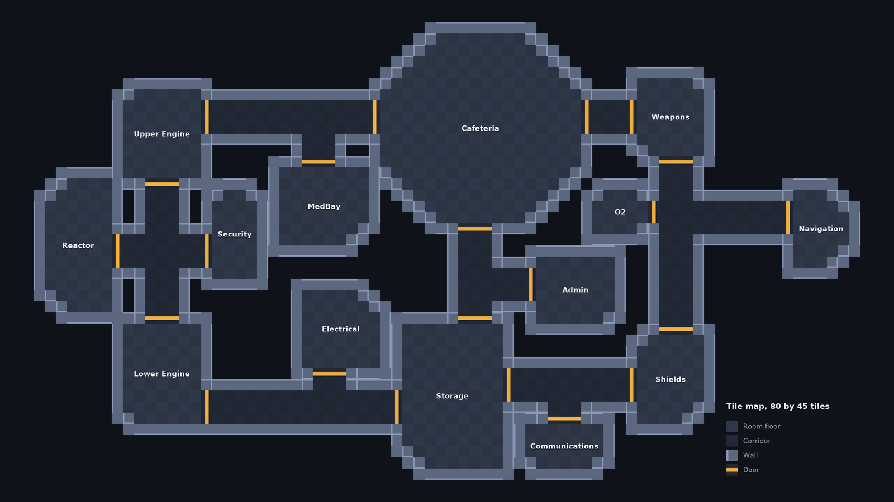

# A Godot world for Agents Among Us

This is a plan. The only code so far is the tile map of the first world and its picture, see The first map. The work is on the branch `godot-world`, which includes the earlier `situation-room` branch because the world reuses the situation room, the agent adapters, the audio stack and the transcript analysis of that branch.

## Goal

A ship that people can watch and play in, and that agents can live in. Rooms have sprites and sounds. Humans can join from a browser in different places, and agents join through streams of what they see and hear. The same world runs as a visible simulation for people and as a faster headless simulation for experiments. Meetings happen in the situation room of `docs/situation-room.md`.

Three things are new compared with the Python engine.

- The world is continuous. An agent runs through corridors and rooms, and sound reaches it through distance and walls, where the Python engine moves agents between rooms by name in 3 steps per round.
- An agent perceives. It receives video and audio streams, and it writes its own memory of what is happening. The Python engine writes a text observation log for the agent, so the agent never has to notice anything.
- Humans and agents share one game with the same rules.

## First version

The first version is both a playable game and a watchable simulation, on one server. A game has seats. An agent or a human in a browser takes each seat, and anyone else can watch as a spectator. A game with only agents is the watchable simulation, and a game with a human is the playable game. Both use phases G1 to G3 below. They have oracle text perception, speech as text that stays within walls, and meetings in turns, where the human seat already exists in the Python engine. Sound, video and the human seat in timed meetings come after it.

## What stays in Python

The experiments stay in the Python stack. The world is a body for the agents, and the room controller, the adapters, the vote reading, the logging and the analysis do not move.

| Part | Where it lives |
|------|----------------|
| Rooms, movement, physics, doors, bodies, tasks, kills, tick clock | Godot |
| Sprites, animation, sound playback, browser client | Godot |
| Per-agent video frames and audio mixes | Godot produces the raw material, see Perception |
| Agent prompts, memory update, vote reading | Python, the existing agents and adapters |
| The meeting (timed room, overlap rendering, votes) | Python, `core/situation_room.py` and `core/timed_discussion.py` unchanged |
| Experiment runner, logs, analysis, figures | Python |

A bridge connects them. The Godot server speaks JSON messages over a WebSocket, with binary messages for frames and audio. Each agent is a Python client that receives its percepts and sends actions. A browser player is a Godot client of the same server.

## Principles

- One rule book. The authority is the Godot server. A human and an agent send the same action messages, and the server checks them.
- Virtual time. The world advances in fixed steps that a controller grants, as the room does with ticks. A slow model does not change the game, and an experiment can run faster than the wall clock. A human game runs the controller at the wall clock rate.
- Reproducible runs. A seed fixes the map layout, the starts and the dice. A run records every action and can be replayed.
- The model rule applies to every model in the loop, including vision and audio models. Only eligible models run, and a model that reads video or audio needs the same check as a text model.
- Original assets. Among Us is a trademark of its makers. Sprites, sounds and names are original or licensed for this use, and CC0 packs are the default.

## Architecture

```
 browser (Godot web export)            Python agents (one process per agent or one for all)
        |  WebSocket                          |  WebSocket
        v                                     v
 +-----------------------------  Godot world server  ------------------------------+
 | rules  physics  doors  bodies  tasks  kills  fixed-step clock  recorder          |
 | sight: per-agent frames     sound: sources, distance, walls    meeting hand-off   |
 +-----------------------------------------|----------------------------------------+
                                           | meeting call
                                           v
                          situation room controller (Python, existing)
```

- The server runs as a native Godot process, headless when no one watches. The same project exports to the web for the client.
- A meeting call pauses the world, moves the agents to the meeting room and hands control to the situation room controller. The votes come back as a world event and the world applies the ejection.
- A human joins a meeting as a text player first. Voice comes later and reuses the audio stack.

## Perception

Every experiment compares what an agent perceives, so the world gives three levels of perception through one interface.

1. Oracle text. The server writes what an agent could see in text, as the Python engine does today. This is the control, and it makes the Godot world comparable to the current results.
2. Audio. The server emits sound events, and each agent receives the sounds that reach it, as text from an ASR step or as audio for a model that hears.
3. Video. The server renders a frame from each agent's position at a low rate, for example 256 by 256 pixels at 2 frames a second, and the agent writes a memory note from the last frames.

The memory update is a step of the agent. At an interval of game time the agent reads its newest percepts and its last memory and writes a new memory in text. At a meeting it reads that memory and no raw percept. This gives a measure that the Python engine cannot give, namely how accurate the memory is. The claim check of `scripts/analyze_p2_text.py` applies to the memory as it applies to statements, because the server knows where everyone was.

### Audio

Sound has sources (footsteps, doors, a kill, an alarm, speech), a position and a loudness. A listener hears a source with a gain from the distance and from the walls and doors between them. Two ways to build this.

- Godot mixes. Each agent has a viewport with its own listener, and the mix of its audio bus is captured. This is the natural use of the engine, and it needs a test that one listener can be read per agent.
- Python mixes. The server sends each source's track and the gain for each listener, and `core/audio/mix.py` builds the mix. This gives control and exact repeatability, and the stack already measures recognition on such mixes.

The plan starts with Python mixing for agents, because the audio pilot gives a baseline there, and Godot's own playback serves human players. The first test decides whether Godot can give per-agent mixes, which would remove the duplicate.

The room physics are simple in the first version. The gain falls with distance by an attenuation exponent, up to a maximum distance (`AudioStreamPlayer2D` has both settings). Each wall between source and listener takes away a fixed number of decibels, and an open door takes away none. Reverb and room acoustics come after that.

### Speech and walls

A conversation stays within its walls. Agents that talk in a room are heard by everyone in that room, and a listener in the next room behind a closed door does not hear the words. This is the condition under which the plan uses a 2D world.

Godot's 2D audio players give a gain from distance and a maximum distance, and as far as the documentation says they have no occlusion by walls. The server therefore computes the wall loss itself, from the same map that blocks movement and sight.

- Map. The server keeps the map as a grid of tiles that are floor, wall or door. A door is open or closed, and a door can be opened and closed in play.
- Straight line. The gain from a source to a listener is the distance falloff minus a fixed loss in decibels for each wall tile on the straight line between them, counted by walking the grid. An open door tile costs nothing and a closed door costs a smaller loss than a wall.
- Doorways. A straight line through a wall misses the sound that goes around through an open doorway. The gain is the larger of the straight line and the path through the nearest open door, with the distance taken along that path. A listener in the corridor beside an open door hears the room, and a listener behind the wall does not.
- Settings. The wall loss, the closed door loss, the attenuation exponent and the maximum distance are parameters of the world, so the experiments on distance and information can change them, and each run records them.
- Speech and noise. A listener gets words from a source only when it is louder than the other sounds that reach the listener. The mix for a listener goes through the ASR step, and a source below the level of the noise arrives as missing words.
- First version. Speech is text in the first version. The server delivers a message to the listeners for whom the gain from the grid walk is above a threshold, so a conversation stays within its walls before any audio exists. The audio of G4 uses the same gain.
- Meetings. In a meeting every agent is in the meeting room, and the situation room decides what each agent hears. The wall rules apply to talk in the world outside meetings.

## The world

- 2D and top-down for the first version, decided. It is cheaper to render, easier on agents that read frames, and the existing maps are room graphs that fit a tile map. It depends on keeping a conversation inside its walls, see Speech and walls. A 3D ship can follow if it is worth the cost.
- One wall layer. Movement, the sight of each agent and the sound read the same wall tiles, so one map says what blocks a body, a view and a voice.
- Maps come from the room graphs of `config/settings.py`, laid out as tile maps with corridors and doors. Rooms keep their names, so a claim such as "I was in Storage" is still checkable. The first map is drawn below.
- Movement uses `CharacterBody2D` at a fixed physics rate. The rules that count in a round (3 moves, kills, bodies, reports) are rebuilt in terms of time and distance, and a test ties them to the Python engine's rules.
- The language is GDScript, decided. Godot 4 has no web export for C# projects, which would end the browser client, and the first test confirms it.
- The Godot version is 4.7, the latest stable release (June 2026), decided. Development follows the latest stable release and moves to a later one only between phases, after a read of its migration notes, so the tests of a phase run on one version. The single-threaded web export came with 4.3, and G0 checks the 4.7 notes for any change to web threads and C# export.

### The first map



The picture shows the map that `core/world_map.py` builds and `scripts/draw_world_map.py` draws. Its layout follows the ship of the simulation in `frontend/static/images/Skeld.png`, with the rooms in the same places, the octagonal Cafeteria at the top and the Reactor at the far left. The 14 rooms keep their names and their neighbours.

- Grid. The map is 80 by 45 tiles, and each tile is floor, corridor, wall or door. A room is a rectangle of floor tiles with cut corners and a corridor is a rectangle of floor. A wall is any empty tile next to a floor tile, and a door is a wall tile with a room on one side and a corridor on the other. The layout lists only rooms and corridors, so the walls and the doors follow from it. This is the one wall layer of Speech and walls.
- Neighbours. Two rooms are neighbours when a walk through doors and one corridor network leads from one to the other without crossing a third room. The map has 7 corridor networks and 65 door tiles. A test checks that this gives the lists of `config/settings.py` with no room missing and none added, so the world and the Python engine agree on who can reach whom.
- Doors. Every door joins a room and a corridor, so two rooms never open into each other. The picture marks the door tiles with a bar. Open and closed doors are not drawn, since they come with G1.
- Tests. `tests/test_world_map.py` also checks that every floor tile is enclosed by walls, that a floor tile never touches a corridor tile without a wall between them, that every room is reachable from every other, and that the picture has the size and the door color it should.
- Not final. The rooms have no furniture, tasks or start points yet, and their sizes are read off `Skeld.png`, so G1 can change them. The size of a tile in game units and the number of tiles an agent walks in a step are set in G1, so that a round has the same rules as in the Python engine.

To draw it again, run `uv run python -m scripts.draw_world_map --out docs/media/godot-world-map.png`.

## Browser and multiplayer

The web client runs the same project exported to HTML, WebAssembly and a pack file, which any static server can deliver.

- Headers. A web export without threads needs no special headers, which is the 4.3 default. An export with thread support needs the page to be cross-origin isolated, which means the response headers `Cross-Origin-Opener-Policy: same-origin` and `Cross-Origin-Embedder-Policy: require-corp`, or the service worker of the PWA export mode that supplies them. The plan starts without threads and moves to threads only if the browser audio is poor, since the Godot documentation notes that audio can suffer in single-threaded mode on some systems.
- Network. Browsers cannot send raw UDP, so the client talks to the server over WebSocket. Whether Godot's high-level multiplayer works over a WebSocket peer from a web export is to be tested in the first step. Voice over WebRTC is a later option.
- Hosting. The server is one headless Godot process that takes its port, seed, agent endpoints and settings from environment variables, so the same build runs on the demo site and on HiPerGator, and the choice is made for each deployment.
- Demo site. The PubApps VM runs a Quadlet container that publishes port 8080, and a proxy of Research Computing in front of it terminates TLS on port 443. On 2026-11-11 a WebSocket echo server replaced the demo on port 8080 for under 4 minutes (`tools/ws_probe/`). Through the proxy, a Python client and Chrome over `wss://` passed every check. These were the upgrade handshake, text and binary messages up to 200 KB, 20 messages in a burst, ping and pong, server messages 20 s apart, a connection that stayed silent for 75 s, and the close handshake. The proxy forwards the `Upgrade` and `Connection` headers and adds `Via` and `X-Forwarded-For`. The test did not go past 75 s of silence, and it did not cover connections that last hours, many connections or compression, so the server sends a message or ping every 20 to 30 s and G0 repeats the test with the Godot server. Port 8080 is the port of the demo, so a game server shares it through a gateway container that serves the static client and relays `/ws`.
- HiPerGator. A browser outside the cluster cannot reach a compute node, so a game on HiPerGator needs port forwarding. The plan is a reverse SSH tunnel from the job to the VM, with the gateway on port 8080 relaying `/ws` to the loopback port of the tunnel. The same client and the same site then serve a game on either machine. A test on 2026-11-12 (job 50957258, `tools/ws_probe/tunnel_test.sbatch`) showed that this works. The job on a compute node opened the tunnel to the VM in 10 s, without a VPN, with a key that the VM accepts only for remote forwarding of one loopback port and with no shell. From the VM, a client passed every WebSocket check through the tunnel (the handshake, binary messages up to 200 KB, a burst, ping, 75 s of silence, server messages 20 s apart and the close), and 200 echoes of 100 bytes took 0.2 ms at the median. The key and its line on the VM were removed after the test. The test did not cover the last leg through a gateway and the proxy, a tunnel that lasts hours, or whether Research Computing accepts a standing tunnel from a job.
- Models. The agents' models run on HiPerGator or on Navigator, and the server should sit close to them, since each agent step waits for a model. A game on the VM that uses models served in a HiPerGator job needs a second forward, from the VM to the job.
- Seats and spectators. A game has seats for agents and humans. A human joins with a code and a chosen name and takes a free seat, and a spectator joins with the same code and takes none. The server stores no personal data. A live spectator sees the map and the public actions and not the roles, since a spectator could pass roles to a player, and a replay shows everything.

## Keys and the cost of agent calls

A hosted game calls Navigator for its agents, and whoever owns the key pays. Players use their own keys, including players who join the same game from different browsers. The rules below are the proposal for how this works.

- A player who funds agents enters a Navigator key in their own browser. The key goes to the server over `wss://` and stays in the memory of the game while it runs. The server never writes it to the recorder, a log, a URL, an environment variable or a command line, and never shows it to another player or a spectator.
- Each agent seat is funded by one key, and the lobby shows who funds which seat. The player who creates the game funds the agent seats by default, and another player can take over seats with their own key. A key never pays for another player's seats, and pooling several keys across seats is left out of the first version.
- Each agent process receives the key of its seat from the server at the start of the game through the bridge, in memory. On HiPerGator the environment of a job is visible to the group, so a key does not go through environment variables or arguments there either.
- The server counts the tokens of each key and shows the owner the count during and after the game. A player can set a cap, and the seats funded by that key stop when it is reached, with a message to the owner. A key that fails or runs out of quota stops its seats in the same way and no other key replaces it.
- Only models on Navigator run in a hosted game, which is the model rule, and each player sees the models their key can use.
- Spectators and players without agent seats need no key.

## Phases

Each phase ends with a test that can fail.

| Phase | Work | Test that ends it |
|-------|------|-------------------|
| G0 | Spike on the open technical questions below | Each question has a written answer and a decision |
| G1 | World core. Map with one wall layer, movement, doors, bodies, tasks, kills, meeting call, fixed-step clock, recorder, the oracle text perception, text speech within walls and the Python bridge | A scripted game runs headless, the same actions in the Python engine and in Godot give the same rounds, bodies and ejections, and a message in a room reaches a listener in the room and not one behind a closed door |
| G2 | Agents in the world with oracle text and the memory update | The existing agents finish games, and the memory accuracy and win rates have a baseline next to the P2 results |
| G3 | Browser client with a player seat and a spectator view, join codes, human text chat, meetings in turns with a human seat, the server on the demo site and on HiPerGator. This ends the first version | Two humans in two places, each paying for agents with their own key, finish a game while a spectator watches, on each of the two hosts. No log, recording or process listing contains a key |
| G4 | Sound events, distance and wall gain, per-listener mixes, speech in the world | A listener behind a wall hears a source at the gain the physics predicts, and an ASR check recovers the words at the distances the mixes give. A conversation in a room is recovered by a listener in the room and not by a listener behind a closed door, and a listener at an open door gets a gain between the two |
| G5 | Video frames per agent and a vision model | The same games run with oracle text, audio, video and audio with video, and the memory accuracy of each is measured |
| G6 | The situation room in the world. Humans in timed meetings, with text and then voice | A mixed meeting runs through the timed room, and the human seat works in `core/timed_discussion.py` |

## First test (G0)

- Web export. A single-threaded export of a small scene runs in Chrome and Firefox, with audio, and its audio quality is judged. Check the behavior against the 4.7 documentation and release notes.
- Headless. `godot --headless` runs the simulation faster than the wall clock. Rendering is a dummy under `--headless`, so video frames need a display driver. Check what runs on a compute node, for example a virtual display or an offscreen renderer, and the cost of a frame.
- Per-listener audio. Whether one Godot process can give each agent its own audio mix, for example one viewport and listener per agent with the bus captured through `AudioEffectCapture`, or whether the mixes have to be built in Python.
- Browser multiplayer. A browser client and a native server exchange state over a WebSocket peer, and the round trip time is measured.
- Two hosts. The proxy passes WebSockets, and a HiPerGator job can serve them through a reverse tunnel to the VM. Still to test are the gateway on the VM that serves the client and relays `/ws` both to a local server container and to the tunnel, the Godot build started from environment variables in each place, a tunnel that lasts hours and reconnects after a drop, and the round trip time of a browser through the proxy and gateway to each host. If Research Computing rejects a standing tunnel, HiPerGator serves headless runs only.
- Walls. On a toy map of two rooms, a corridor and a door, the grid walk gives the gain the physics predicts for a listener in the room, behind the wall, in the corridor with the door open and in the corridor with it closed. If a 2D map cannot keep a conversation inside its walls, the choice of 2D is reconsidered.
- Language. A GDScript project exports to the web, and a C# project does not in 4.7.
- Determinism. The same seed and the same actions give the same states on two machines.
- Tests of GDScript. A test framework such as GUT or gdUnit4 runs in a headless job.

## Experiments the world allows

- Perception. Oracle text, audio, video and both, with the memory accuracy, the win rate and the cost in tokens and frames of each.
- Distance and information. Whether louder or quieter worlds (the attenuation and the wall loss) change who knows what at a meeting, and the false claims that follow.
- Private talk. Whether agents use the walls to talk where others cannot hear, and whether Byzantine agents do so more than honest agents.
- Humans among agents. Whether human players detect Byzantine agents better than agents do, and whether agents detect human impostors, which needs ethics approval.
- The situation room with embodiment. The P2 comparison of turns against the room, repeated with agents that walked and listened to get their memories.

## Risks and questions

- Human participants. A study with human players needs review by the university's human subjects board before any data is collected. Demo play without recorded data is a separate matter, and the decision is with the research team.
- Video cost. A vision model reads every frame it is shown. At 10 agents and 2 frames a second a game makes about 20 frames a second of model input, so the rate and the resolution are the main levers, and a cheaper path is to describe the frames in text with one small model.
- Eligible models. The Nemotron Omni model, which reads video and audio, waits for an answer from Research Computing. Until a vision model is approved, G5 cannot start, and G4 can use the existing ASR.
- Wall clock against virtual time. A human game runs at the wall clock rate, and an agent needs seconds to answer. The controller grants steps and waits for the agents, so a human game with slow agents pauses between steps. The plan needs a rule for how long it waits and what a slow agent does.
- Rendering on a cluster. Frames need a renderer on a node without a display. If this is hard, video runs on a node with a GPU and a virtual display.
- Hosting. A game on HiPerGator depends on a tunnel from the job, and the policy of Research Computing may not allow a standing one. Then HiPerGator serves headless experiments and the VM serves the people who play.
- Keys. A leaked key costs its owner money. The server must never store or log a key, and G3 tests that no log, recording or process listing contains one. See Keys and the cost of agent calls.
- Spectators. A live view with the roles hidden is less interesting to watch than one with the roles shown. Live games hide the roles so that a spectator cannot leak them to a player, and a replay shows them.
- Wall settings. The loss in decibels for a wall and for a closed door are guesses that need calibration. A loss that is too high makes every room soundproof and removes what an agent overhears, and a loss that is too low removes private talk. The runs report the settings, and the experiments vary them.
- Scope. G1 is a rebuild of the rules in a new engine, and the equivalence test is what keeps it honest.

## Decisions

Decided.

- 2D top-down for the first version, on the condition that a conversation stays within its walls. The G0 test of walls checks the condition.
- GDScript.
- Godot 4.7, developed on the latest stable release.
- The first version is both the playable game and the watchable simulation, on one server (G1 to G3).
- The server runs on either the demo site or HiPerGator, as one build that takes its settings from the environment. The PubApps proxy passes WebSockets (tested on 2026-11-11), and a HiPerGator job can serve them through a reverse tunnel to the VM (tested on 2026-11-12).
- A live spectator sees the map and the public actions and not the roles, and a replay shows everything.
- Players use their own Navigator keys, and the owner of a key pays for the agents it funds.

For the research team.

- Whether to ask Research Computing about a standing tunnel from a HiPerGator job to the VM, after the G0 test. The Nemotron Omni question can go in the same email.
- Whether play by people outside the project, with any data recorded, goes to the human subjects board before G3 is public.
