# Situation Room

Design for timed, simultaneous discussion in Agents Among Us, plus the experiments that use it.
Status is design, two HiPerGator pilots (vLLM concurrency and the audio stack), and a text-only integration. Phases 0 and 1a are done. The room, the three text renderers, the tick loop, the vote tick, an in-process transport and a scripted adapter exist and are tested with no GPU, as do `core/audio/` and the benchmark scripts. The engine runs a full game in `timed` mode with the existing honest and Byzantine agents, through an adapter, against any OpenAI-compatible server, and a smoke test ran 2 rounds of 10 agents through `main.py` against a fake server. P2 has played 659 games against models served on HiPerGator (Granite 3.3 8B, gpt-oss-120b and Gemma 4 31B, with one more Gemma game that timed out before its first move), and the `File` transport is still to do. Work happens on the `situation-room` branch.

## Goal

Replace turn-taking with a situation room. All agents speak during the same timed window, their speech overlaps, and each agent works out who said what, and why, from the combined record.
Text is one modality. Agents also hear each other as audio and learn who is talking through diarization. They argue their points by answering the justifications they heard.
The experiments compare how models handle this across scenarios.
They run on HiPerGator with local models and make no API calls.
They run in English. The game prompts, the scenarios and the agents' speech are English, Kokoro uses American English voices, and Whisper is set to English.

Each agent is an adapter that hears the room and replies to it. An adapter can run in the controller process, on its own GPU, on another node, or behind an API, and the room does not change.

## How discussion works today

- `GameEngine.run_discussion_phase` (`core/game_engine.py:694`) loops over agents in a fixed order, caller first, for `num_discussion_messages` passes.
- Each agent reads its role's discussion log file (`participate_in_discussion`, `agents/honest_agent.py:159`), so every message sees all earlier ones. No two agents speak at once.
- `vote()` reads the same file (`agents/honest_agent.py:221`), and votes are cast one agent at a time.
- In CONTROLLER mode each generation writes a JSON request file and polls for the reply (`core/llm.py:373`). `worker.py` serves one request at a time with a single-prompt HF `generate`, so parallel calls would queue on the GPU.
- Request ids use `time.time()` and the pid, which can collide across threads.
- Nothing is seeded. `core/state.py` picks start rooms with `random.choice`.

## Design

### Virtual clock

Discussion runs on a virtual clock. Each word costs `1 / words_per_s` seconds of room time for every model.
Inference speed has no effect on who gets to speak, so a 70B model and an 8B model are charged the same.
A wall-clock timer can be added later as its own scenario if inference latency becomes a variable of interest.

| Parameter | Default | Meaning |
|-----------|---------|---------|
| `discussion_mode` | `turns` | `turns` keeps today's behavior, `timed` uses the situation room |
| `budget_s` | 180 | Length of the discussion in room time. The default is generous so agents can argue before the vote |
| `tick_s` | 10 | Time between decision points |
| `words_per_s` | 2.5 | Speaking rate in the `text` modality, about 150 words per minute. The `audio` modality uses the length of the synthesized speech |
| `max_words` | 40 | Words per utterance. The prompt states the limit and the room drops any words beyond it |
| `max_tokens` | 96 | Generation limit per reply, a guard against runaway output |
| `onset_jitter_s` | 2 | Seeded delay before a speaker starts within a tick. In the `audio` modality it sets how much speakers overlap |
| `tts_speed` | 0.85 | Kokoro speaking speed in the `audio` modality. At 1.0 Kokoro spoke about 3 words per second, and 0.85 brings it near `words_per_s` |
| `quiet_close_ticks` | 3 | Close early after this many ticks with nobody speaking, 0 disables. The discussion never closes while someone is still talking |
| `overlap` | `clean` | `clean`, `interleaved` or `noisy` |
| `window_s` | 2 | Width of one interleaving window |
| `dropout` | 0.0 | Fraction of words replaced by `[inaudible]` in `noisy` mode |
| `tag_policy` | `every_chunk` | `every_chunk` or `first_chunk` speaker tags in `noisy` mode |
| `modality` | `text` | `text` or `audio`, what agents hear and say. Set per agent or for the whole room |
| `diarization` | `oracle` | `oracle`, `estimated` or `none`, how speaker identity reaches an agent in the `audio` modality |
| `barge_in` | `off` | With `on`, an agent that is mid-utterance can reply at a tick, which cuts off its current utterance at that moment. No experiment uses it, and no interruption is planned |
| `seed` | none | Controls start rooms, seating, onset jitter, dropout and sampling |

These sit in the composition JSON next to `skip_discussion` and `num_discussion_messages`.

### Tick loop

```
t = 0
while t < budget_s:
    ready = adapters of active agents whose last utterance has finished by t
    for a in ready:
        a.hear(room.percept(a.name, t))
    replies = collect(a.reply(Tick(t)) for a in ready)
    for r in replies:
        if not silent(r):
            room.append(r.agent, r.text, start=t + jitter(r.agent, t))
    t += tick_s
room.close(budget_s)
```

- All ready agents hear the same room state at `t` and reply in parallel. The controller commits the replies after every reply has arrived or the timeout passes. A missing reply counts as silence.
- An utterance occupies its speaker from `start` to `start + words / words_per_s`. The speaker cannot speak again until it ends, unless `barge_in` is `on`. In the `audio` modality the duration is the length of the synthesized speech.
- Listeners at later ticks hear only the words spoken so far. A 40-word message that starts at 0 s takes 16 s, so a listener at the 10 s tick has heard its first 25 words.
- Words not yet spoken when the budget closes are dropped.
- At tick 1 everyone has heard only the meeting report, so most agents speak at once. Later ticks are replies to what was heard.
- Replying `<silent/>` keeps an agent quiet for that tick.
- A tick lasts as long as its slowest reply, so `max_words` and `max_tokens` bound the tail.
- A meeting costs at most `budget_s / tick_s` calls per active agent. With 10 agents and the defaults that is 180 calls against 20 today. Busy agents make no call and silent replies are short, and prefix caching reduces the prompt cost.

Voting becomes one more simultaneous tick. Every agent sees the final snapshot and votes in parallel. The tally and ejection logic stay as they are.

### The room

The room is a grow-only map of per-author logs.

```
Utterance  author, tick, start_s, pace_s, words, intended, cursor, addressed_to
Lane       append-only list of one author's utterances, written by that author only
Room       lanes by author, free_at(author), append(), percept(reader, t, tick), close(t),
           statements(), ground_truth(), write_jsonl()
```

- Each lane has a single writer, so merging lanes is a union and nothing conflicts. A read takes a frozen snapshot and merges the lanes by timestamp with `heapq.merge`.
- The controller is the only committer, so the room needs no locks. Concurrency sits in the agent adapters, which generate in parallel.
- Everything in a run follows from the seed and the logged replies, so transcripts can be audited and analyses reproduced.

Alternatives considered.

- A lock-protected shared list with arrival-order posting. Message order would follow GPU speed, and model speed would become a game variable.
- Redis or Kafka. A new service on HiPerGator with no benefit at 10 writers.
- Asynchronous posting on the wall clock. It has the same arrival-order problem as the shared list.

### Agent adapters

The room knows nothing about models, GPUs or APIs, and it stores only public speech. Each agent is an adapter that hears the room and replies to it.
Private state (role, action log, results log) stays with the adapter. The controller hands it over once, at the start of a meeting.

```
Percept   reader, tick, t, cursor, modality, text, audio_ref, speakers
Tick      tick, t, remaining_s
Reply     agent, tick, text, addressed_to, or silence
Vote      agent, target

AgentAdapter
    begin_meeting(meeting, private)     role, action log, results log, meeting reason
    hear(percept)                       speech since the adapter's cursor
    reply(tick) -> Reply                an utterance, or silence
    vote(percept, candidates) -> Vote
    end_meeting()
```

| Adapter | Where the agent runs |
|---------|----------------------|
| `InProcessAdapter` | Wraps today's agent classes and `ModelManager` in the controller process. Tests, small runs and the PubApps demo |
| `VllmAdapter` | Calls a vLLM server through the existing `OpenAICompatibleClient`. One GPU per agent, or several agents per GPU |
| `ApiAdapter` | Navigator, OpenAI or Anthropic through the existing clients. Not used for the HiPerGator experiments |
| `RemoteAdapter` | A proxy for an adapter running in another process or node, reached over a transport |
| `HumanAdapter` | The existing human input path, added later |

The composition JSON picks a backend per agent. When it does not, the model name decides as it does today, with a provider prefix meaning API and a Hugging Face id meaning local.

A percept is a snapshot of everything the reader has heard, and its `cursor` is the room time it covers. The `interleaved` and `noisy` renderings only grow from tick to tick, so each prompt extends the last and a vLLM server can reuse the cached prefix. The `clean` rendering rewrites an utterance as it grows and does not have that property. Delivering only what is new since the cursor is a later optimization.

Each adapter receives only its own render. Other readers' renders, dropout masks and the ground truth stay with the controller.

`Percept.modality` is `text` or `audio`. For `audio`, `audio_ref` points to the reader's mix on the shared filesystem and `speakers` lists the diarization labels the reader is allowed to see. The next section describes how an adapter hears and speaks in each modality.

The v1 barrier needs every adapter to reply once per tick. The same interface supports adapters that hear continuously and post when ready, which is the wall-clock scenario listed under open questions.

### How the existing agents take part

The honest and Byzantine agents read the discussion from log files, so `GameAgentAdapter` builds its own prompt and leaves the agent classes unchanged. At the start of a meeting it builds the agent's view of the game once on the controller thread, because building a view changes game state, and reads the agent's memory log and the results log. At each tick it asks the model for the next statement using the agent's own system prompt, so the role and objective stay the same.

The room prompt keeps each role's behavior rules from the turn-based prompts, including the Byzantine rule never to confess. It replaces the rule of 45 to 80 words with the room's word limit, and adds the rules of a timed meeting, `<silent/>` and `<to>Name</to>`. The reply is generated with a phase label of `ROOM`, because the generator retries any `DISCUSSION` reply under 45 words and silence is a valid reply here. With thought capture on, the agent writes `<think>` first and the existing retry for missing tags applies.

For the vote the adapter writes what the agent heard to a per-agent file under `room/` in the game's log folder, in the format the agent's `vote()` already reads, and substitutes that path for the shared discussion log. Each agent therefore votes on its own interleaved view, and the files record what each one heard.

Some behaviors differ from turn-taking and need to be known when reading results.

- The statement limit is `--room_max_words` (40 by default), and `run_p2.py` and `run_p2.sbatch` pass it through (`ROOM_MAX_WORDS`). Above 40 words the prompt asks for a few sentences instead of one or two short ones. A word is about 1.3 tokens, so a limit above about 100 words also needs a larger `AAU_MAX_TOKENS`.
- The token budget of a reply is the agent's own (160, or 384 with thought capture). The room's `max_tokens` setting is not used yet, and `max_words` cuts the words after generation.
- `ModelManager` returns `move` when an API call fails. The adapter treats that as silence, so it is never committed as a statement. A failed vote is asked again, as the next section describes.
- Agents generate in parallel, up to `room_workers` at once. `main.py` sets 1 when the model runs in the same process. A lock in `GameState` guards the live-state file and the thought history.
- The Observer classifiers receive the room's statements with `S_Num` capped at `num_discussion_messages`, as turn-taking caps it.
- A game with a human seat falls back to turn-taking for its meetings, and hybrid pruning is not applied in the room.
- Every `vllm:` model is checked against the eligible list when the game is set up, and the engine has no Qwen override.

### Required votes

Every model agent must vote for another agent. The vote prompts no longer offer `SKIP` and tell the agent it must vote, and `--allow_skip` restores the old rule. A reply that names no candidate is asked again up to `--vote_retries` times (2 by default) at sampling temperatures 0.1, 0.7 and 1.0. When an agent still has no valid vote, the engine rewinds the meeting and runs it again from its first tick or first turn.

The rewind cuts the meeting's lines out of `discussion.log` and `discussion_chat.csv`, which the agents read, and saves them with the votes that were collected in `voided_meetings.jsonl`. The room's record is renamed to `room/room_round<N>_voided<K>.jsonl`, and a meeting held again uses other onset delays. After `--meeting_attempts` attempts (3 by default) the game stops with `MeetingFailed`, and `run_p2.py` records it as a failed game with `stopped_for_votes`. Votes reach `vote.log` and the stats only after every agent has voted, so a rewound meeting leaves no votes behind. The token counters keep the calls of rewound meetings, because they were paid for.

Three rules stay as they were. A tie ejects nobody. A human seat may still skip, and its skip does not rewind a meeting. A rewound meeting in turn-taking mode asks a human seat for its messages again. The runner records `redone_meetings` for each game, and the summarizer prints the share of honest ballots skipped and the meetings redone per game.

A reply is read by `agents/vote_reading.py`. A reply that is only a name, or that follows a phrase such as "I vote for", is settled by rules. So is a reply that mentions one name that is not negated, which fixes the old reading in which "Agent_5, not Agent_2" voted for Agent_2. A reply with several names and no marker, or one that describes the candidate, goes to the voter's own model with the meeting text it heard, and the model must answer with a candidate or NONE. Each reading is written to `votes.jsonl` with its method (`exact`, `marker`, `single`, `llm`, `ambiguous` or `none`), so a run shows how often replies needed the model. A dependency parser was not used, because a language model also resolves "the one who claimed to be in Electrical", and the compute nodes cannot download a model for it.

A vote reply can also fail before the rules read it. The first reruns showed Gemma agents with an empty reply at every temperature, which came from the reply cleaning described under the analysis below, and a prompt longer than the server's context, which `run_p2.sbatch` now avoids with a 32k context and counts as `api_errors`.

### Transports

Messages are plain JSON, so an adapter can run in another process, on another GPU or node, or behind an API without code changes.

| Transport | Use |
|-----------|-----|
| `InProcess` | Direct calls on a thread pool. Tests and single-GPU runs |
| `File` | JSON files in the IPC directory on the shared filesystem, one inbox and one outbox per agent, written with an atomic rename. Follows the convention in `worker.py` and `core/llm.py`, and works across SLURM nodes without opening ports |
| `Network` | HTTP or ZeroMQ carrying the same JSON. Later |

The controller owns the virtual clock, so adapters with different latencies stay in step. A reply tagged with an earlier tick is discarded and logged.

### Hearing and speaking

An adapter is made of an ear, a brain and a mouth. The brain is the language model that decides what to say. It runs on a vLLM server or an API and does not change with the modality.

| Part | Job | `text` modality | `audio` modality |
|------|-----|-----------------|------------------|
| Ear | Turns a percept into model input | `TextEar` passes the rendered transcript | `SeparatedEar` recognizes each speaker's audio on its own and labels it according to `diarization`. `MixEar` recognizes the reader's mix as one stream. `NativeEar` passes the audio to an audio-capable model |
| Mouth | Turns a reply into an utterance | `TextMouth` stores the words with timestamps | `TtsMouth` synthesizes speech in the agent's voice, and timestamps come from the audio length |

Ears and mouths are chosen per agent, so one game can mix modalities.

The audio pipeline.

1. Each agent gets a voice at game start, drawn with the seed. The voice is the agent's speaker identity for the whole game.
2. The mouth writes a WAV file to the shared filesystem. The room stores the text, the audio path and the duration. Onsets stay on the virtual clock, so synthesis speed does not affect the game.
3. The room mixes audio per reader. The mix at time `t` sums every other speaker's audio up to `t`, each placed at its start offset. The reader's own voice is left out, which takes the place of `(you)`. The overlap is acoustic, and the controller does not cut or reorder anything. Per-speaker gain and background noise take the place of `dropout`.
4. The ear hands the brain what it can use. A separated ear transcribes each speaker's audio on its own and writes the same interleaved transcript the `text` modality uses, with the labels `diarization` allows. This is the clean-audio condition. A mix ear transcribes the reader's mix as one stream, which is the cocktail-party condition. A native ear sends the waveform since the reader's cursor together with the labels.
5. The mix and the transcripts are logged, so any reader's view of any tick can be replayed.

Whisper large-v3 (speech recognition) and Kokoro (speech synthesis) are both in Navigator's catalog, so the audio stack follows the same rule as the language models. Both run from the `/blue` cache on HiPerGator, as the P1b measurements below show.

Three components are not on Navigator and wait for approval.

- Native ear. None of Navigator's language models takes audio, and the Gemma 4 31B config has `audio_config: null`. The one candidate found, `nvidia/Nemotron-3-Nano-Omni-30B-A3B-Reasoning-BF16`, is not in Navigator's catalog, builds on a Nemotron 3 Nano backbone that is itself excluded, and its card says it was improved using Qwen models. It is excluded, and a question about it is with Research Computing. The native ear has no model until an eligible one is found.
- Model-based diarization. `nvidia/Nemotron-3-Diarization` is a streaming Sortformer with the OpenMDW license and no gating. Until it is approved, `estimated` labels come from the oracle labels with errors injected at a chosen diarization error rate, which also makes that rate a controlled factor.
- Speech separation. The mix ear needs it to do better than Whisper alone.

### Diarization

Speaker identity is its own channel, with 3 levels.

| Level | What the agent receives |
|-------|-------------------------|
| `oracle` | The exact speaker labels and segment times from the room. In the cascade ear every transcribed span is tagged with the true speaker |
| `estimated` | Labels with errors that agents can see. They come from a diarization model run on the mix, or from the oracle labels with injected errors until a model is approved. Errors merge or split speakers and miss overlapped speech |
| `none` | No labels. The agent separates speakers by voice and content, which needs a native ear. A cascade ear delivers unlabeled text |

A roll call before the discussion, outside the budget, lets each agent say its name once. Under `none`, that is how agents bind voices to names. In the audio modality agents are called by color name, such as Red and Orange, because `Agent_3` is hard to say and to recognize.

The `text` modality has matching conditions. `every_chunk` tags correspond to `oracle`, `first_chunk` tags to a degraded channel, and removing tags to `none`. That allows comparing modalities at matched diarization.

The room records the true segments, so the diarization error rate for each reader and meeting is logged under `estimated`. Game outcomes can then be related to how well speakers were identified.

### Arguing

Agents argue by answering what others said. They need the justification and the speaker, which is why audio quality and diarization are experiment factors.

- The prompts ask an agent to address speakers by name, answer the justification it heard, and give its own.
- A reply may begin with `<to>Agent_5</to>`. The room stores the names as `addressed_to` and keeps them in the spoken text, so the reply is shown and synthesized as "Agent_5, ...". The names stay because models also wrap a name in the tag in the middle of a sentence, and deleting the tag would delete the name.
- Every utterance records the cursor its speaker had at the start, so analyses can link a rebuttal to what the speaker had heard.
- An agent answers an accusation at the first tick at which it has finished speaking. Agents are not interrupted, and a statement ends when its words are spoken or the meeting ends.

Measures of arguing.

- Rebuttal rate. The accused addresses the accuser within 2 ticks.
- Answered justification, scored with an LLM judge. `config/judge_prompts.py` already has a judge that flags a changed suspect given without justification, and it extends to rebuttals.
- Persuasion. Votes move toward a target after an argument against it.
- Consistency. Claimed locations match the ground-truth action log, reported separately for crew and impostors.

### Rendering text

A reader at time `t` sees the words in each lane with timestamp below `t`.

`clean` shows one block per utterance with its time span. Utterances still in progress show the words spoken so far followed by `...`.

```
[00:00-00:14] Agent_3: I found the body in Electrical and saw Agent_5 leaving.
[00:01-00:11] Agent_5: I was in MedBay with Agent_4 the whole time, it was not me.
[00:12-...  ] Agent_7: Agent_3 reported fast, that seems ...
```

`interleaved` cuts words into `window_s` windows. Each line is one speaker's words in one window, and lines with the same timestamp were spoken at the same time.

```
[00:00] Agent_3: I found the body in
[00:00] Agent_5: I was in MedBay with
[00:02] Agent_3: Electrical and saw Agent_5 leaving
[00:02] Agent_5: Agent_4 the whole time it
```

`noisy` is `interleaved` plus dropout and, with `tag_policy=first_chunk`, speaker tags only on a speaker's first line.

```
[00:00] Agent_3: I found the body in
[00:00] Agent_5: [inaudible] was in MedBay [inaudible]
[00:02] Electrical and saw Agent_5 leaving
[00:02] Agent_4 the whole time [inaudible]
```

Rules for every mode.

- A reader's own words are marked `(you)`.
- Simultaneous lines are shuffled per `(seed, reader, window)`, so position bias averages out across games and the order of earlier lines does not change from tick to tick.
- Dropout masks come from `(seed, reader, utterance, word index)`. Words a reader missed at tick k stay missed at tick k+1.
- Agents are told that everyone speaks at once, that words may be interleaved, and how much room time remains.

### Ground truth and the Observer

The clean utterances with start times go to `room.jsonl`, together with every reader's render at every tick.
The discussion log used by the UI and the Observer input (`Agent`, `Text`, `Reported`, `S_Num`) come from the clean utterances, and `S_Num` becomes the utterance index per author.
The SGD, SVM and LR classifiers were trained on sequential transcripts, so their scores will shift. Treat them as a measurement per protocol, since they are not calibrated probabilities here.

## Code changes

| File | Change |
|------|--------|
| `core/situation_room.py` | Done in Phase 0. `RoomConfig`, `Utterance`, `Lane`, `Room`, the message types (`Meeting`, `Tick`, `Percept`, `Reply`, `Vote`), `parse_reply`, and the `clean`, `interleaved` and `noisy` renderers |
| `core/adapters/` | `base.py` (the `AgentAdapter` protocol), `scripted.py` (a deterministic fake for tests and dry runs) and `game_agent.py` (wraps an existing honest or Byzantine agent) are done. The wrapped agent reaches a model through `ModelManager`, so the `vllm` and API providers need no adapter of their own. `remote.py` is still to write |
| `agents/room_prompts.py` | Done in Phase 1a. The room instructions for each role, built on the turn-based behavior rules |
| `core/adapters/ears.py`, `core/adapters/mouths.py` | New. `TextEar`, `SeparatedEar`, `MixEar`, `NativeEar`, `TextMouth`, `TtsMouth` |
| `core/audio/` | Started in P1b. `mix.py` (per-reader mix, overlap, WAV), `metrics.py` (word error rate, recall), `tts.py` (Kokoro voices) and `asr.py` (Whisper) exist and are tested. `diarize.py` is still to write |
| `core/transport.py` | `InProcessTransport` is done, with a `max_workers` limit for a model loaded in the same process. The `File` transport is still to write, with `Network` left for later |
| `core/timed_discussion.py` | The tick loop over adapters and the simultaneous vote tick are done. The turn-based runner stays in `core/game_engine.py` as the control |
| `core/game_engine.py` | Done in Phase 1a. `discussion_mode` (`turns` or `timed`), `room_config` and `room_workers` select and set the runner. The vote bookkeeping moved into `_record_vote`, which both modes use. Every model agent has to vote, and a meeting without a valid vote is rewound and held again (`allow_skip`, `vote_retries`, `max_meeting_attempts`). A `vllm:` model that is not on the eligible list stops the game at setup |
| `core/api_clients.py` | A `vllm` provider that talks to the server at `VLLM_BASE_URL` and needs no key. Model names look like `vllm:ibm-granite/granite-3.3-8b-instruct` |
| `main.py` | `--discussion_mode`, `--room_budget_s`, `--room_tick_s`, `--room_max_words`, `--room_overlap`, `--room_seed`, `--room_workers`, `--allow_skip`, `--vote_retries` and `--meeting_attempts`. A composition file may set `discussion_mode` |
| `core/state.py` | A lock around the live-state save and the thought publishing, because agents generate in parallel. Seeded start rooms are still to do |
| `agents/honest_agent.py`, `agents/byzantine_agent.py` | The adapter builds the room prompt itself and calls the agent's own system prompt, vote method and model client. `vote()` drops the offer to skip when `SKIP` is not a candidate, returns `None` for a reply that names nobody, and reads the sampling temperature from `vote_temperature` |
| `agents/prompts.py` | The room reuses its behavior rules and the `<think>` appendix idea. `require_vote()` removes the offer to skip from a voting prompt |
| `agents/vote_reading.py` | Reads which candidate a vote reply chooses, with rules first and the voter's model for the replies the rules cannot settle |
| `scripts/make_figures.py` | Draws the figures of this doc from `docs/figures/data.json`. `data` collects the numbers from the P2 results, the game folders and the doc's tables, and `plot` draws the PNG files with `uv run --with matplotlib python -m scripts.make_figures plot` |
| `scripts/analyze_p2_text.py` | Reads the transcripts of P2 games and measures speech acts, claims about places checked against the agents' own observation logs, accusations, the influence of accusations on honest votes, and what agents pick up from the room |
| `scripts/make_replay.py` | Renders one meeting of a recorded game as an MP4, a GIF and still frames, with Pillow and ffmpeg. It draws the seats, the speech as it was spoken, the lanes of who spoke when, the votes and the result. The replay of seed 3 of gpt-oss-120b in `interleaved-180` is in `docs/media/` and in the README |
| `core/world_map.py`, `scripts/draw_world_map.py` | The tile map of the first Godot world and a drawing of it in `docs/media/godot-world-map.png`. `build_map()` turns room and corridor rectangles into floor, corridor, wall and door tiles, and `adjacency()` finds the neighbours of each room by walking the corridors. A test checks them against `config/settings.py` |
| `core/voting.py` | `ask_until_valid()` asks again while a reply names no candidate, at rising temperatures |
| `core/logger.py` | Unchanged. The engine writes `room/room_round<N>.jsonl` and each agent's final percept to the game's log folder |
| `scripts/hipergator/run_game.sbatch` | Done. Starts a vLLM server and times full games in each mode in `MODES` |
| `config/protocols.py` | Done. The 11 P2 protocols as `main.py` flags. The noisy cells drop 10% of the words and tag only each speaker's first line |
| `scripts/run_p2.py`, `scripts/summarize_p2.py` | Done. The runner plays the grid with several games at once and resumes after a stop. The summarizer prints win rate with a Wilson interval, vote accuracy, skipped votes, redone meetings, rounds, meetings, statements and minutes for each model and protocol |
| `scripts/hipergator/run_p2.sbatch` | Done. Starts a vLLM server on one GPU and runs the P2 grid against it |
| `submit_games.sh` | Longer time limit, vLLM startup, seed from the array index |
| `tests/test_situation_room.py` | pytest with a fake generator and no GPU |

Tests cover merge order across lanes, truncation at the deadline, busy agents skipping ticks, dropout stability across ticks, and that one seed reproduces one transcript.
Audio tests check that the mix places each speaker at its offset, leaves out the reader's own voice, and that the recorded duration equals the length of the WAV file.
A transport test plays the same game with fake deterministic adapters in the controller process and again in separate processes over the `File` transport, and expects identical `room.jsonl` files.
Run them with `uv run --with pytest python -m pytest tests`.

The human seat is not supported in timed mode in v1.

## Running on HiPerGator

vLLM runs on HiPerGator. The byzantine-agents project (`scripts/hipergator/` under `/home/christan/toblue/christan/projects/byzantine-agents`) supplies the recipe.

- `env.sh` puts `HF_HOME`, `UV_CACHE_DIR`, `VLLM_CACHE_ROOT` and `TORCH_HOME` under `/blue/ufdatastudios/christan/cache`, because the home directory is 40 GB.
- `vllm_serve.sbatch` runs `uv run --no-project --with vllm vllm serve <model>` under account and QoS `ufdatastudios` and writes `endpoints/<job id>.url`.
- Partitions are `hpg-turin` (L4, 24 GB), `hpg-rtx6000` (RTX PRO 6000, 96 GB) and `hpg-b200` (B200, 180 GB). The QoS allows 16 GPUs at a time, shared with the group.
- Per-model flags that were needed there. gpt-oss needs `--attention-backend TRITON_ATTN`. Llama weights are gated and need the Hugging Face token. Multi-GPU servers need `NCCL_IB_DISABLE=1 NCCL_P2P_DISABLE=1` and a list of excluded nodes.
- A server must not sit idle. byzantine-agents queues a release job that cancels it after the last grid, and the situation room jobs do the same.

The plan for this project.

- One vLLM OpenAI-compatible server per model per GPU, started by the SLURM script. Each writes its base URL to an endpoint file, as in byzantine-agents, and adapters read it in place of the `ready_*.signal` files.
- Each `VllmAdapter` calls its server through the existing `OpenAICompatibleClient`. Adapters reply in parallel, so vLLM batches the simultaneous requests for one server.
- Placement is a setting. By default agents of the same model share a server. Setting `placement` to `per_agent` starts one adapter and one server per agent with `srun --gpus-per-task=1`, up to one GPU per agent. The room and the tick loop are the same either way.
- Adapters on different nodes use the `File` transport over the shared filesystem.
- Automatic prefix caching is on, because each tick resends a longer version of the same prompt.
- Each request includes a sampling seed derived from `(seed, agent, tick)`.
- The lightweight tier fits several models per GPU as in `submit_games.sh` today, with `gpu_memory_utilization` per server summing below 1. The heavy tier needs tensor parallelism across GPUs.
- Experiment jobs set no Navigator, OpenAI or Anthropic keys, and those providers are disabled when `LLM_MODE=VLLM`.
- Batch composition changes numerics, so regenerating a game gives different text. The logged transcripts are the record.
- Prompt layout is fixed as system prompt, private memory, the append-only board, and the tick instruction last. Each tick then extends the previous prompt, which lets the prefix cache work.

### Measured concurrency on one L4

`scripts/bench_vllm_concurrency.py` sends the requests of a tick all at once to a vLLM 0.33.0 server on an NVIDIA L4 (24 GB) with an 8B model in bf16. The prompts are synthetic and about 1.3k tokens, with temperature 1.0 and `max_tokens` 160. Each concurrency row is the median of 3 rounds whose prompts share almost no prefix with an earlier round (3% to 8% of tokens came from the cache), and the sequential row is a single run. Neither server logged a preemption.

The first run used Llama 3.1 8B, which Navigator retired on 2026-08-10 and which is not on the eligible list. The second run uses Granite 3.3 8B, an eligible model, and is the reference. The result files are in `results/bench/`.

| Requests at once | Granite 3.3 8B round time | Llama 3.1 8B round time |
|------------------|---------------------------|-------------------------|
| 1 | 0.7 s | 0.6 s |
| 2 | 1.2 s | 3.0 s |
| 5 | 3.8 s | 11.3 s (one reply ran to the 160-token limit) |
| 10 | 6.9 s | 6.6 s |
| 20 | 13.6 s | 14.0 s |
| 10, one after another | 14.2 s | 24.7 s |

- Batching helps. 10 simultaneous requests finish in 6.9 s on Granite against 14.2 s one after another, which is 2.1 times faster. Granite's replies are short, about 14 tokens on average, so there is less to overlap. Llama's replies averaged about 40 tokens and the gain was 3.7 times.
- An L4 is at capacity near 10 agents. The round time doubles from 10 to 20 requests on both models, so the limit is mostly prompt processing of about 13k tokens per tick. A larger GPU would shorten the tick, and the prefix cache reduces the prompt cost, as the next point shows.
- The tick lasts as long as its slowest reply. On Granite one reply ran to the 160-token limit at tick 4 and the round took 11.5 s against 2.9 s to 6.3 s for the other ticks. This is the reason for `max_words` and `max_tokens`.
- The growing-board test uses 10 agents over 6 ticks. On Granite the prompt grows from 616 to 2,004 tokens, and the share of prompt tokens served from the prefix cache was 16%, 66%, 74%, 79%, 82% and 85% for ticks 1 to 6. Llama gave 18% to 85% on shorter prompts.
- A 6-tick meeting of 10 agents takes about 34 s of wall time on Granite, plus a voting tick. The default 18-tick meeting would take roughly 1.7 minutes. The movement phase is still sequential and has not been measured. It is likely to dominate game time, and P1 will measure it.
- The L4 result covers two 8B models and synthetic prompts. The next section adds two larger models on another GPU.

### Measured concurrency on an RTX PRO 6000

Jobs 50715127 and 50715128 ran the same script on one RTX PRO 6000 (96 GB) with two more eligible models, gpt-oss-20b and Gemma 4 31B. The GPU differs from the L4 above, so the two tables are not a comparison of models alone.

| Requests at once | gpt-oss-20b round time | Gemma 4 31B round time |
|------------------|------------------------|------------------------|
| 1 | 0.7 s | 2.8 s |
| 2 | 0.9 s | 3.2 s |
| 5 | 1.2 s | 4.1 s |
| 10 | 1.5 s | 5.5 s |
| 20 | 1.9 s | 8.9 s |
| 10, one after another | 6.7 s | 30.5 s |

- Gemma 4 31B finishes 10 simultaneous requests in 5.5 s against 30.5 s one after another, which is 5.5 times faster. Its replies averaged 56 tokens. The 6-tick growing-board meeting took 22 s in total, and 84% of prompt tokens came from the prefix cache by tick 6.
- gpt-oss-20b produced exactly 160 completion tokens on every request in every round, so the cap ended each one. The model reasons before it answers, and the server's `openai_gptoss` reasoning parser keeps the reasoning apart from the reply, so the budget probably ran out before any reply text. These round times measure reasoning up to the cap and say little about game replies. A game with gpt-oss needs a larger token budget or a low reasoning effort, and the first run has to check that replies are not empty. The same applies to gpt-oss-120b.
- A retest of gpt-oss-20b at a limit of 1024 tokens (job 50749200) separates the two causes. At the default reasoning effort, 40% to 60% of replies were still empty at 5 to 20 simultaneous requests, because the reasoning used almost the whole budget, with mean completion lengths of 770 to 1024 tokens. At `reasoning_effort` low, no reply was empty. Replies averaged 65 to 194 tokens with a maximum of 394, 10 simultaneous requests took 2.4 s, and the 6-tick meeting took 13 s in total. A larger budget alone is not enough, so gpt-oss runs need low reasoning effort and a limit of several hundred tokens. `AAU_MAX_TOKENS` and `VLLM_REASONING_EFFORT` set them, and `run_game.sbatch` and `run_p2.sbatch` pass them to the games.

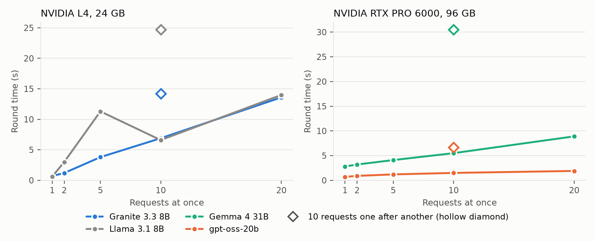

Figure 1. Round time against the number of requests sent at once. The hollow diamond marks 10 requests sent one after another. The two GPUs differ, so the panels do not compare the models.

### Measured game time (P1a)

Jobs 50742388 and 50744516 played full games of 10 agents (8 honest, 2 Byzantine) on Granite 3.3 8B served on one RTX PRO 6000. Each game had 3 rounds, thought capture off, a discussion budget of 180 s and 10 s ticks. The first job played 1 game per mode. It showed that every statement began with an address tag and that two thirds ran past the 40-word limit, which the fix in commit 119381f addressed. The second job played 2 games per mode on the fixed code and is the reference. The timing records are in `results/room_runs/`.

| Game | Mode | Wall time | Meetings | Statements |
|------|------|-----------|----------|------------|
| 50744516_timed_1 | timed | 135 s | 2 | 108 |
| 50744516_timed_2 | timed | 162 s | 3 | 150 |
| 50744516_turns_1 | turns | 161 s | 1 | 14 |
| 50744516_turns_2 | turns | 94 s | 1 | 12 |

- A 180 s meeting took 16 s to 25 s of wall time (5 meetings) and produced 32 to 70 statements. The room asks only the agents that have finished talking at each tick, so the batches stay small. The number of statements falls from meeting to meeting as agents are ejected or killed.
- The movement phase is the larger share of a game. Subtracting the meetings leaves roughly 25 s to 30 s per round, and the movement phase runs one agent at a time. A 10-round game with a meeting in most rounds would take about 7 minutes at this rate, which is a rough extrapolation from 3 rounds.
- Room statements averaged 26 to 28 words, and 6% to 14% were cut at the 40-word limit, down from 66% and 77% in the first job. No statement began with a comma, and no game had an API error or an empty reply.
- Turn-taking statements averaged 76 and 97 words against the room's 26 to 28. The logs do not time a turn-taking meeting, so the two modes cannot be compared per meeting. A comparison needs the same number of agents and the same round on both sides.
- 99% of room statements still include an address tag, although the prompt says most statements need none. Granite treats the tag as part of the format, so addressing is a default of this model. Either the tag leaves the prompt or the experiments record it as always on.
- The room never closed early. In every meeting some agent was still speaking in the last ticks, so `quiet_close_ticks` has not been exercised on a served model.

### Reasoning models

A reasoning model spends completion tokens on reasoning before it writes the reply. Those tokens take time within a tick, and they can use the whole token limit and leave an empty reply.

Every experiment records the reasoning effort it ran with (`VLLM_REASONING_EFFORT`, or `default`) and the reply limit (`AAU_MAX_TOKENS`), and each game records totals for its model. The totals are completion tokens, reasoning tokens, replies that stopped at the limit and empty replies, and they are written to `stats.csv` as `api_*` columns. The server's own count of reasoning tokens is used when it reports one. Otherwise the count is estimated by splitting the completion tokens in proportion to the characters of reasoning text and reply text, and `api_reasoning_estimated_calls` says how many replies were estimated. The reasoning share is reasoning tokens over completion tokens. `scripts/summarize_p2.py` prints it for each model, effort and protocol, next to the tokens per call, the share of replies cut at the limit and the share of empty replies. The benchmark records the same, with the 50th and 90th percentile of completion length.

What the benchmark shows. Jobs 50751707 (gpt-oss-20b) and 50751708 (gpt-oss-120b) sent the same prompts with a limit of 4096 tokens at each reasoning effort. The ranges run over 1, 2, 5, 10 and 20 simultaneous requests, and every reasoning count was reported by the server.

| Model | Effort | Mean tokens per reply | 90th percentile | Longest | Reasoning share | Cut at 4096 | Empty | 6-tick meeting |
|-------|--------|-----------------------|-----------------|---------|-----------------|-------------|-------|----------------|
| gpt-oss-20b | low | 79 to 138 | up to 232 | 307 | 24% to 49% | 0% | 0% | 11 s |
| gpt-oss-20b | medium | 898 to 1,409 | up to 2,613 | 4,096 | 91% to 95% | 5% in one round | 5% in one round | 102 s |
| gpt-oss-20b | high | 3,584 to 4,096 | 4,096 | 4,096 | 100% | 80% to 100% | 80% to 100% | 199 s |
| gpt-oss-120b | low | 132 to 203 | up to 305 | 368 | 54% to 66% | 0% | 0% | 20 s |
| gpt-oss-120b | medium | 1,217 to 2,171 | up to 2,429 | 3,291 | 94% to 97% | 0% | 0% | 127 s |
| gpt-oss-120b | high | 3,979 to 4,096 | 4,096 | 4,096 | 100% | 95% to 100% | 95% to 100% | 343 s |

The answer to how many tokens reasoning needs depends on the effort. Low effort fits in 512 tokens and a limit of 768 leaves a wide margin. Medium effort averages 900 to 2,200 tokens, reaches 4,096 in about 1 reply in 20 on the 20b model, so a limit of 6,000 or more is prudent. High effort on both models did not finish within 4,096 tokens in most replies, so its length is above that. A meeting of 6 ticks takes 11 s to 20 s at low effort, 100 s to 130 s at medium and 200 s to 340 s at high. The 120b model at high effort also used the whole 4,096 tokens in 95% to 100% of replies. High effort is not usable in the room with these models.
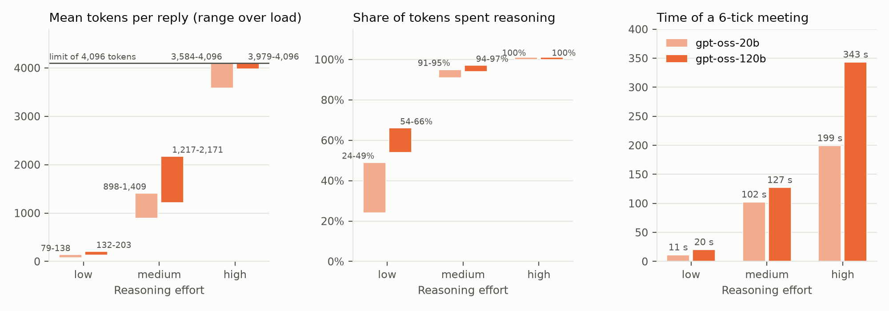

Figure 2. gpt-oss at each reasoning effort with a limit of 4,096 tokens. The bars of the first two panels span the range over 1 to 20 simultaneous requests.

For comparison the benchmark replies of Granite 3.3 8B averaged 13 tokens and those of Gemma 4 31B 56 tokens. Benchmark prompts are synthetic, and a game prompt that asks for one room name may need fewer reasoning tokens than one that asks for an argument. The game test (job 50751709) played 3 rounds in each mode with gpt-oss-20b at low effort and a limit of 768 tokens. The timed game made 175 calls that averaged 110 completion tokens, 64% of them reasoning, with a longest reply of 391 tokens, no reply cut at the limit and none empty. The turn-taking game made 78 calls that averaged 100 tokens, 44% of them reasoning, with a longest reply of 327 tokens. Room statements averaged 28 words against 93 words in turn-taking. The timed game took 141 s and the turn-taking game 77 s, each with 2 meetings, and the Byzantines won both. The totals mix movement, discussion and voting calls, so the reasoning share of each phase is not yet known.

Gemma 4 reasons inside its reply. Its think block is part of the reply text and no server parser separates it, so the client counts a think block in a reply as reasoning tokens (an estimate from characters) and treats a reply with no text outside the block as empty. A probe with the vote prompt of a failed game gave a think block of 160 tokens at every temperature, with the finish reason `length`. Gemma needs a limit of 1,024 tokens (`AAU_MAX_TOKENS`) so that the block closes before the answer. In the P2 runs the reasoning share of the completion tokens is 64% for gpt-oss-120b at low effort, 31% for Gemma 4 31B with that limit (38 games), 9% for Granite 3.3 8B by default and 73% when Granite writes private reasoning (`CAPTURE=1`, a limit of 384 tokens, with 2% of the replies cut).

Loading gpt-oss-120b needs more than 64 GB of host memory. The first P2 job for it (50755230) was killed for memory while loading, and the rerun requests 128 GB.

The clock does not charge for reasoning. An agent that decides at tick t starts speaking within the onset jitter after t, however long its reasoning ran on the GPU, so reasoning is free in game time and costs only wall time. A person who thinks before speaking talks later. Two options follow.

- Charge reasoning tokens to the clock. A reply with k reasoning tokens starts k divided by a `think_tokens_per_s` setting after the tick, and a reply that runs past the end of the discussion is dropped. The speed of reasoning then becomes a factor of the game, and methods that reason faster can be compared by what they win, such as lower effort, shorter chains, drafts from a small model, or a small model that reasons for a large one.
- Keep the clock and compare efforts by quality and wall time only.

The first option is a design choice and is not implemented.

### Measured audio stack (P1b)

`scripts/audio_pilot.py` synthesizes scripted 20-word statements with 10 Kokoro voices, mixes them the way the room would for a silent listener, and transcribes the result with Whisper large-v3 in fp16 on an NVIDIA RTX PRO 6000. The result file is `results/audio_pilot/summary_50646536.json`. The WAV files stay on HiPerGator in `results/audio_pilot/wav_50646536/`.

- Synthesis takes about 0.07 s per statement for 6.8 s of audio. At speed 1.0 Kokoro speaks about 3 words per second, which is why `tts_speed` defaults to 0.85.
- Clean speech is recognized almost perfectly. The mean word error rate over the 10 statements is 0.5% and the worst is 4.5%. A batch of 10 takes 1.2 s. Any loss in the audio conditions therefore comes from overlap.
- Overlap is the problem. Speakers start at random times within 2 s of each other, and each row averages 10 trials with a random subset of speakers.

| Speakers at once | Overlapped share of speaking time | Word recall | Precision | Speakers recovered |
|------------------|-----------------------------------|-------------|-----------|--------------------|
| 1 | 0% | 99.6% | 99.6% | 100% |
| 2 | 77% | 52% | 99.6% | 55% |
| 3 | 79% | 44% | 97% | 50% |
| 5 | 83% | 24% | 90% | 26% |
| 10 | 88% | 12% | 62% | 6% |

- Whisper keeps one stream and drops the others. It can also fuse two. With Green and Brown speaking, the transcript read "I was in storage with Purple, and we both finished our tasks, so I think Purple is lying about where they were". The first half is Green's, and Green accused Red. The accusation of Purple is Brown's. An agent reading that line would hear evidence that nobody gave.
- At 10 speakers precision falls to 62%, so 38% of the recognized words appear in no speaker's text.
- Time labels cannot attach words to speakers in a mix. When 2 or more people spoke, only 11% to 13% of the recognized words fell at a moment with exactly one speaker active, against 97% for a single speaker.
- Recognizing one mix took 1.0 s to 2.9 s on average. One batch of 10 reader mixes of 10 s took 1.2 s in the first run and 18 s in the second. The slow batch probably contained a repetition loop on babble, so Whisper's generation length needs a cap per window.

What this means for the design.

- The default audio ear is the separated ear, which recognizes each speaker's stream on its own. The mix ear is the stress condition, and its difficulty follows how many agents speak at once.
- At tick 1 every agent speaks at once, so a mix ear would recover about 12% of the words. `onset_jitter_s` is the lever for overlap, and the next P1b step maps word recall against overlap share with wider onsets.
- A mix ear that does better than Whisper alone needs a speech separation model.
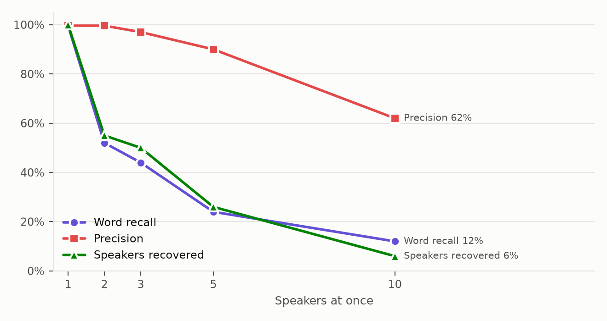

Figure 3. Whisper large-v3 on a mix of Kokoro voices. Each point averages 10 trials.

### Model eligibility

Florida Statute [288.860](https://www.flsenate.gov/Laws/Statutes/2025/288.860) defines the foreign countries of concern as the People's Republic of China, the Russian Federation, Iran, North Korea, Cuba, the Maduro regime in Venezuela and Syria, with the entities they control. The byzantine-agents README records that UF Research Computing's acceptable-use policy (new user training, Module 4) bars large language models from organizations in those countries on any UF computing resource, and that fine-tuning does not make them acceptable. Qwen comes from Alibaba in China, so it falls under that policy.
The experiments follow two rules. The model must also be served by Navigator, so results apply to the Navigator demo. Neither the model nor its post-training may come from a country of concern. That excludes the Qwen family and DeepSeek, models built on them (Athene V2, Arcee Nova and OpenPipe Qwen3 14B), and any model whose card says it was improved using them. It removes most of the HW and LW lists in `config/model_composition.py`.
`config/eligible_models.py` enforces the rules. It lists the eligible models, matches Qwen, DeepSeek and other family names, and gives the reason for each exclusion. The HiPerGator job scripts run `python -m config.eligible_models <model>` before they start a server, and the job fails for any model that is not on the list.
A Qwen checkpoint gets a warning and does not start unless someone types the override phrase, as `--override "<phrase>"` on the command or `QWEN_OVERRIDE="<phrase>"` on the `sbatch` line. The warning prints the phrase and advises confirming with Research Computing first. The override opens Qwen names only. DeepSeek and the other families, and the models excluded for a card that cites Qwen, stay refused.
The table lists the eligible models with the Hugging Face checkpoint to use. Navigator may serve a different revision or quantization, so each run records the checkpoint revision.

| Navigator model | Hugging Face checkpoint | Class | On /blue |
|-----------------|-------------------------|-------|----------|
| `ministral-8b` | `mistralai/Ministral-8B-Instruct-2410` (research license) | 8B | no |
| `granite-3.3-8b-instruct` | `ibm-granite/granite-3.3-8b-instruct` | 8B | yes |
| `gpt-oss-20b` | `openai/gpt-oss-20b` | 21B MoE | yes |
| `mistral-small-3.1` | `mistralai/Mistral-Small-3.1-24B-Instruct-2503` | 24B | no |
| `magistral-small` | `mistralai/Magistral-Small-2506`, `-2507` or `-2509`, to match Navigator | 24B reasoning | no |
| `gemma-4-31b-it` | `google/gemma-4-31B-it` | 31B | yes |
| `meta-muse-glimmer-30b` | `meta-models/Muse-Glimmer-30B`, which Navigator's lifecycle page may list as legacy | 30B | no |
| `llama-3.3-70b-instruct` | `meta-llama/Llama-3.3-70B-Instruct` | 70B | yes |
| `gpt-oss-120b` | `openai/gpt-oss-120b` | 117B MoE | yes |

The audit on 2026-11-10 read the public model card of every Navigator open-weight model and of the audio models, looking for a Qwen, DeepSeek or other Chinese-origin base, teacher or reward model. The 9 models above are clean. Their cards mention Qwen or DeepSeek only in benchmark tables and Chinese only as a supported language. The Llama 3.3 70B card is gated, so its check rests on the base model in its metadata, Llama 3.1 70B, and Muse Glimmer 30B lists no base model.

Excluded after the audit.

- `llama-3.1-nemotron-nano-8B`. The card says "Improved using Qwen".
- `nemotron-3-nano-30b-a3b`. The card says "Improved using Qwen", and its reinforcement learning used a reward model built on Qwen3.
- `nemotron-3-super-120b-a12b`. The card names GPT-OSS-120B as one teacher and leaves the others unnamed, so Qwen or DeepSeek outputs cannot be ruled out. It returns to the list if its dataset card shows otherwise.
- `nvidia/Nemotron-3-Nano-Omni-30B-A3B-Reasoning-BF16`, the native-ear candidate. The card says it was improved using Qwen3-VL-30B-A3B-Instruct, Qwen3.5-122B-A10B, Qwen3.5-397B-A17B, Qwen2.5-VL-72B-Instruct and gpt-oss-120b. Its architecture section names the excluded Nemotron 3 Nano 30B-A3B as the language backbone. The training data table lists Qwen models as annotators for most of its public datasets, and also DeepSeek OCR, GLM-4.1V-9B-Thinking and Kimi-K2.5 for a few. Navigator does not list it. The license is the NVIDIA Open Model Agreement.
- `medgemma-27b-it`, which is tuned for medicine and not used in the game.

The audio stack passed. Whisper large-v3 (OpenAI) and Kokoro (built on StyleTTS 2) have no Chinese-origin base, and the audio environment has no packages from the Qwen or DeepSeek ecosystems. `nvidia/Nemotron-3-Diarization` is an NVIDIA model, but it trains on Mandarin meeting corpora (AISHELL-4 and AliMeeting), which its pending approval should consider.

The 8B models fit one L4 or part of an RTX PRO 6000. The 70B and 120B models need 2 or more GPUs, as the byzantine-agents notes describe.
The reasoning models (gpt-oss and Magistral) spend part of `max_tokens` on thinking, so their limit needs its own check in P1.

## Experiments

| Phase | Question | Setup | Games |
|-------|----------|-------|-------|
| P0 | Does the room behave correctly | Done. 46 tests with a scripted adapter and no GPU. Three deliberately injected bugs (always-ready agents, a shuffle that depends on the tick, a barge-in that does not cut) each made a test fail | 0 |
| P1 | What does a game cost and does it read well | 1 GPU, 1 small model, 5 games per protocol. Measure minutes per game and parse failures, check that `interleaved` is legible, tune defaults. Run one game with each agent on its own GPU to confirm the barrier works across processes | about 25 |
| P1b | Does the audio stack work | Done once on 1 RTX PRO 6000 with Kokoro and Whisper large-v3, see Measured audio stack. Still to do. Map word recall against overlap share with wider onsets, cap Whisper's generation length, and test a speech separation model once it is approved | 0 |
| P2 | How much does the protocol matter | 3 models (small, medium, large), homogeneous. Sequential, timed `clean`, `interleaved` and `noisy` at budgets 60, 180 and 300 s, and no discussion. 11 cells per model, 50 games per cell | 1,650 |
| P3 | How does each model perform | Each of the 9 eligible models as crew against a fixed reference model as impostors, then swapped, under sequential, timed `clean` and timed `interleaved`. 50 games per cell | 2,700 |
| P4 | Which knobs matter | `tick_s` 5, 10, 20. Impostors 1, 2, 3. `dropout` 0, 0.1, 0.3. 9 cells per model, 50 games per cell, on 1 or 2 models | 450 per model |
| P5 | Does hearing change the game | Text `interleaved` as the baseline. Audio with a separated ear at `oracle` and `estimated` diarization. Audio with a mix ear as the cocktail-party stress test. A native ear at `oracle` and `none` if a model is approved. 4 cells per model without the native ear, 50 games per cell, on 1 or 2 models | 200 per model, plus 100 for the native ear |

Run the models that fit on one GPU first.

P2 runs from `scripts/hipergator/run_p2.sbatch`. One job serves one model on one GPU and plays the grid 6 games at a time, each game in its own `main.py` process. A seed visits all 11 protocols before the next seed starts, so an interrupted run still has paired cells, and a job resubmitted with the same `TAG` plays only the missing games. The scenario seed fixes the start rooms. Sampling is not seeded, so games with one seed diverge after the first move, and the pairing controls the start and not the whole game.
The pilot plays 5 seeds per cell with thought capture off and 10 rounds, which is 55 games per model. It started with Granite 3.3 8B and Gemma 4 31B, the models that fit on one RTX PRO 6000 and were measured above, and gpt-oss-120b joined as the large model at low reasoning effort with a limit of 768 tokens. All three models were extended to 20 seeds, which is 220 games each. One Gemma game, the sequential game of seed 18, made no progress after it started and timed out, so Gemma has 219 finished games. Llama 3.3 70B waits for two GPUs.
The reference model for P3 is chosen after P2, from the models whose win rate is stable across protocols.

Every protocol replays the same seeds, so scenarios differ only in how agents talk.

Metrics.

- Win rate by role, vote accuracy (`correct_votes` over `correct_votes + incorrect_votes`), skipped votes, rounds survived, ejection of an impostor in the first meeting.
- Words spoken before the cutoff and fraction of ticks spent silent, by model and role.
- Parse failures, tokens, calls and wall-clock minutes per game.
- Observer classifier scores by protocol.
- The measures of arguing listed above, and the diarization error rate for each reader under `estimated`.

Comprehension probe. In 20% of meetings, a discarded extra call after the last tick asks each agent which agents each speaker mentioned. The answers are scored against the name mentions in the clean utterances, as precision and recall per reader. No LLM judge is needed, and the call leaves the game state unchanged.

Sizing. At 50 games per cell the 95% interval on a win rate is about ±14 points, and about ±10 at 100 games. Start with 20 games per cell to screen, then add games to the cells that matter. Fit `win ~ model * role * protocol + (1 | seed)` for the final comparison, with Wilson intervals for single cells.

### P2 results

The results come from three runs on one RTX PRO 6000 each, with 10 rounds, thought capture off, 6 games at a time and every agent required to vote. Granite 3.3 8B ran with its defaults (tag `v7-granite`, 220 games). gpt-oss-120b ran at low reasoning effort with a limit of 768 tokens (tag `v4-gpt-oss-120b`, 220 games). Gemma 4 31B ran with a limit of 1,024 tokens (tag `v6-gemma`, 220 games planned and 219 finished). The sequential game of seed 18 wrote the line that loads its config and nothing after it, and it ended at the limit of 3,600 s per game with no round played, so the sequential cell of Gemma has 19 games. The stall came before any model call, and its cause is not known. Earlier pilots of these models had defects that this section's runs removed, which were the skipped votes, the quotation cleaning, the context limit, Gemma's cut thinking and a shared config file. Their numbers are not kept.

| Model | Setting | Games | Honest wins | Honest vote accuracy | Meetings redone per game | API errors | Reasoning share | Minutes per game |
|---|---|---|---|---|---|---|---|---|
| Granite 3.3 8B | no discussion | 20 | 10 (50%) | 59% | 0.10 | 0 | 67% | 2.4 |
| Granite 3.3 8B | turns | 20 | 2 (10%) | 32% | 0.25 | 0 | 21% | 4.3 |
| Granite 3.3 8B | timed room | 180 | 45 (25%) | 38% | 0.02 | 0 | 7% | 3.7 |
| gpt-oss-120b | no discussion | 20 | 3 (15%) | 35% | 0.00 | 0 | 83% | 3.1 |
| gpt-oss-120b | turns | 20 | 6 (30%) | 45% | 0.10 | 0 | 56% | 4.7 |
| gpt-oss-120b | timed room | 180 | 64 (36%) | 44% | 0.00 | 0 | 64% | 5.1 |
| Gemma 4 31B | no discussion | 20 | 14 (70%) | 69% | 0.00 | 0 | 97% | 26.5 |
| Gemma 4 31B | turns | 19 | 6 (32%) | 47% | 0.00 | 0 | 41% | 19.5 |
| Gemma 4 31B | timed room | 180 | 67 (37%) | 39% | 0.00 | 0 | 29% | 22.3 |

Honest vote accuracy is the share of honest votes that went to a Byzantine, and a random pick among the other agents would score about 22% to 30%. A skipped vote no longer exists, so a meeting that lacks a vote is rewound, and the table gives the rewinds per game. No game stopped for a missing vote and no call failed with an API error. Gemma returned an empty reply 10 times in 46,445 calls, 8 of them with no discussion, where its thinking is longest. The reasoning share is the share of completion tokens that are reasoning, from the server where it reports them and from the think blocks in the reply for Granite and Gemma.

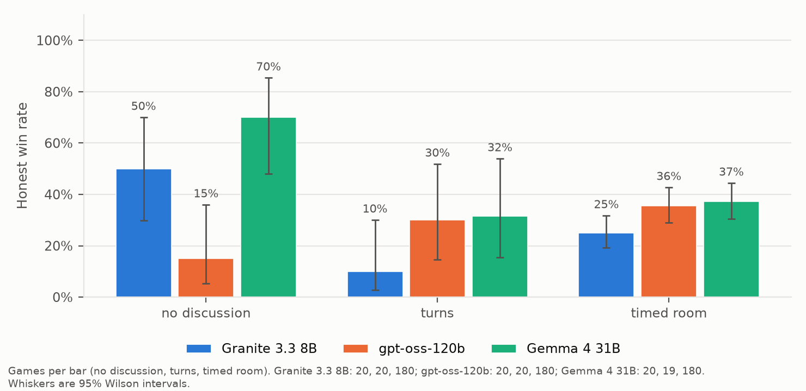

Figure 4. Honest win rate by setting, with 95% Wilson intervals. The number of games behind each bar is under the figure.

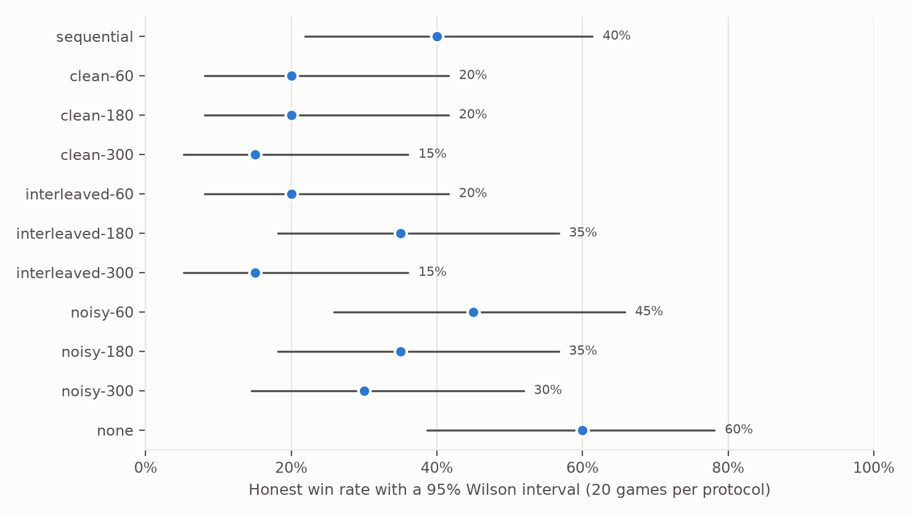

Figure 5. Granite 3.3 8B in each protocol, with 20 games in each cell. The intervals are 27 to 40 points wide, and no timed protocol stands out from the others.

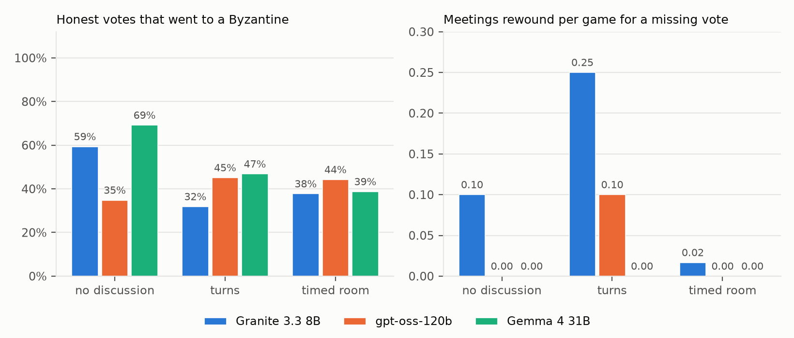

Figure 6. Accuracy of the honest votes that were cast, and the meetings rewound per game, by setting.

- Only the cells of the timed rooms (180 games each) have narrow intervals. gpt-oss wins 36% of its timed games (95% interval 29% to 43%), Gemma 37% (30% to 44%) and Granite 25% (19% to 32%). The no-discussion and turn cells have 19 to 20 games and their intervals run 27 to 40 points wide.
- Granite and Gemma show a cost for discussion. Granite wins 10 of 20 games with no discussion (50%, interval 30% to 70%), 2 of 20 in turns (10%, 3% to 30%) and 45 of 180 in timed rooms (25%). Gemma wins 14 of 20 (70%, 48% to 85%), 6 of 19 in turns (32%, 15% to 54%) and 67 of 180 in timed rooms (37%). A Fisher exact test of no discussion against turns gives p = 0.014 for Granite and p = 0.026 for Gemma, and of no discussion against timed rooms p = 0.031 and p = 0.007. The tests treat the games as independent and were not adjusted for the 6 contrasts of the 3 models. Only the Gemma contrast with timed rooms stays below 0.05 after a Bonferroni correction (0.05 / 6 = 0.008), so the tests are a guide and the cluster-robust intervals are still to do.
- gpt-oss shows no cost. It wins 3 of 20 games with no discussion (15%, 5% to 36%), 6 of 20 in turns (30%, 15% to 52%) and 64 of 180 in timed rooms (36%), which points the other way, and p = 0.45 for no discussion against turns and p = 0.081 against timed rooms. No setting beats another for gpt-oss in these data.
- Honest vote accuracy is 32% to 59% for Granite, 35% to 45% for gpt-oss and 39% to 69% for Gemma. Granite and Gemma vote more accurately with no discussion (59% on 246 votes and 69% on 240 votes) than with it (Granite 32% in turns and 38% in timed rooms, Gemma 47% and 39%), and each of these values is above the 22% to 30% of a random pick.
- A game takes 2.4 to 4.3 minutes for Granite, 3.1 to 5.1 for gpt-oss and 19.5 to 26.5 for Gemma, whose reasoning share is 97% when there is no discussion and 29% in the timed room.

### What agents say and believe

The analysis reads the game folders of the three runs with `scripts/analyze_p2_text.py`. It uses rules and not a model, so the labels are approximate. I checked the accusations by hand on 40 statements drawn after the rules were written. The rules reported 28 accusations and 23 were right (82%), and they found 23 of the 38 accusations I read in those statements (61%). Most misses are implicit, as in "let's focus on Agent_8's alibi" or "voting for Agent_3". The rules undercount accusations, so some candidates in the rows "accused by nobody" were accused, which narrows the contrasts between rows. The check of claims about places is a lower bound, because a claim counts as false only when it was not true at any earlier tick of the agent's own observation log. Only the finished games are read. Every row below is the clean room, with the turn-taking rows beside it, and the cells of turn-taking have 4 to 20 games.

What each role says. Each cell is the share of statements with that kind of speech act, and a statement can have several.

| Model | Setting | Role | Statements | Words | Accuse | Call a vote | Defend self | Report | Question | Cut at the limit | Opens with a name |
|---|---|---|---|---|---|---|---|---|---|---|---|
| Granite 3.3 8B | clean | Byzantine | 2096 | 28 | 50% | 11% | 20% | 37% | 20% | 11% | 98% |
| Granite 3.3 8B | clean | Honest | 5784 | 26 | 64% | 27% | 10% | 37% | 12% | 8% | 97% |
| Granite 3.3 8B | turns | Byzantine | 168 | 88 | 70% | 21% | 43% | 58% | 6% | - | 0% |
| Granite 3.3 8B | turns | Honest | 441 | 90 | 87% | 36% | 33% | 75% | 10% | - | 0% |
| gpt-oss-120b | clean | Byzantine | 2882 | 25 | 46% | 19% | 2% | 22% | 14% | 3% | 39% |
| gpt-oss-120b | clean | Honest | 7302 | 29 | 80% | 67% | 9% | 41% | 4% | 5% | 31% |
| gpt-oss-120b | turns | Byzantine | 174 | 75 | 87% | 65% | 18% | 97% | 0% | - | 0% |
| gpt-oss-120b | turns | Honest | 510 | 80 | 99% | 93% | 35% | 95% | 0% | - | 0% |
| Gemma 4 31B | clean | Byzantine | 2500 | 27 | 46% | 28% | 3% | 7% | 21% | 4% | 89% |
| Gemma 4 31B | clean | Honest | 5922 | 29 | 69% | 54% | 2% | 23% | 13% | 2% | 84% |
| Gemma 4 31B | turns | Byzantine | 146 | 66 | 82% | 39% | 25% | 46% | 19% | - | 3% |
| Gemma 4 31B | turns | Honest | 406 | 66 | 87% | 36% | 13% | 76% | 6% | - | 9% |

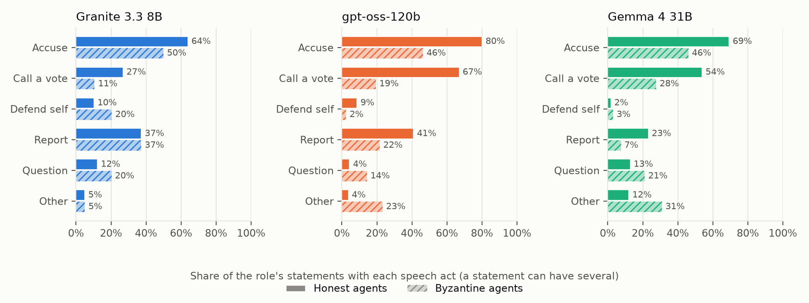

Figure 7. Speech acts in the clean room. Solid bars are honest agents and hatched bars are Byzantine agents.

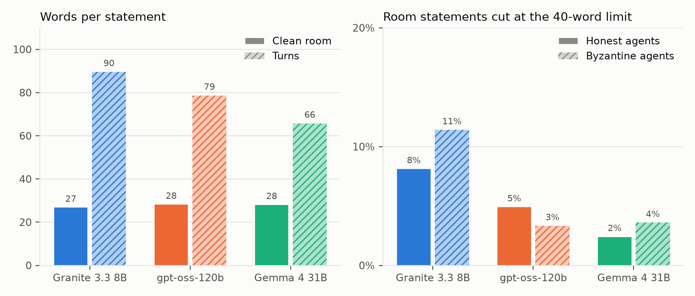

Figure 8. Words per statement in the room and in turns, and the share of room statements cut at the 40-word limit.

Statements in the room average 25 to 29 words against 66 to 90 in turns, and the 40-word limit cuts 2% to 11% of them, most for Granite. A higher limit would therefore change few statements, and the instruction to answer in one or two short sentences is the stronger limit. Honest gpt-oss agents accuse in 80% of their statements and call a vote in 67%, against 19% for its Byzantines. Byzantine agents ask questions more often than honest agents in all three models (20% against 12% for Granite, 14% against 4% for gpt-oss and 21% against 13% for Gemma). Byzantine Gemma and gpt-oss agents report what they saw less often than honest ones (7% against 23%, and 22% against 41%), and Granite's Byzantines report as often as its honest agents (37% and 37%). Granite and Gemma open most room statements with the name of the agent addressed (97% to 98% and 84% to 89%), which is the address tag, and gpt-oss does so in 31% to 39%.

What agents believe and how well they hear.

| Model | Honest false claims | Byzantine false claims | Honest accusations at a Byzantine (chance) | Same, turns | Byzantine accusations at a Byzantine (chance) | Honest vote for an honest candidate accused only by Byzantines | Same, only by honest agents | Same, by both | Honest votes for the most accused agent (turns) |
|---|---|---|---|---|---|---|---|---|---|
| Granite 3.3 8B | 29% | 39% | 29% (29%) | 34% (30%) | 13% (13%) | 10% (n=215) | 15% (n=474) | 39% (n=725) | 58% (74%) |
| gpt-oss-120b | 20% | 20% | 40% (30%) | 42% (29%) | 10% (14%) | 6% (n=508) | 10% (n=516) | 43% (n=814) | 76% (77%) |
| Gemma 4 31B | 17% | 30% | 35% (31%) | 46% (29%) | 9% (15%) | 8% (n=214) | 8% (n=323) | 55% (n=708) | 78% (76%) |

Chance is the share of Byzantines among the other active agents at the time of the statement. An honest agent that is told nothing would aim 28% to 32% of its accusations at a Byzantine.

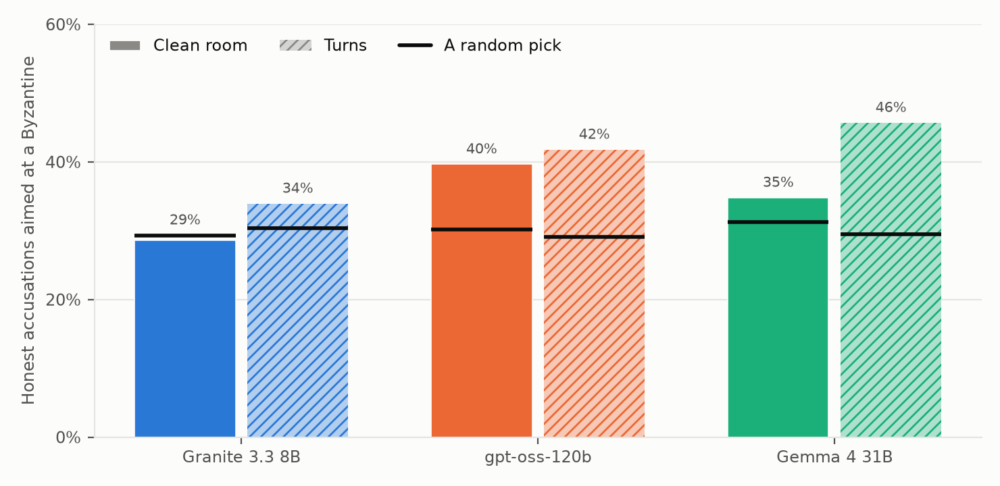

Figure 9. Honest accusations that were aimed at a Byzantine. The black mark on each bar is the share a random pick among the other active agents would give.

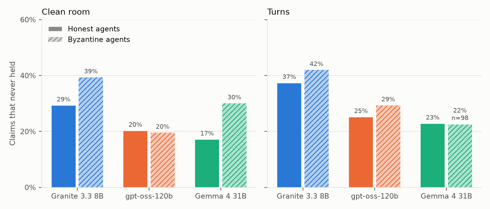

Figure 10. Claims about places that never held at any earlier tick. Solid bars are honest agents and hatched bars are Byzantine agents.

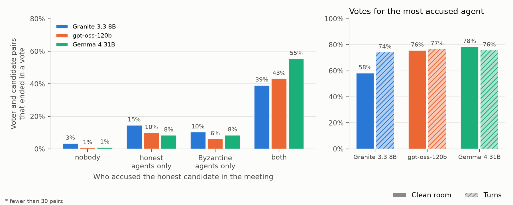

Figure 11. Honest votes for an honest candidate by who accused that candidate in the meeting (left), and the share of honest votes that went to the most accused agent (right).

- Believability. Granite's Byzantine agents make false claims about places in 39% of their claims and its honest agents in 29%. gpt-oss shows no difference (19% and 21%), and Gemma's Byzantine agents are at 30% against 17% (326 and 2,048 claims). Honest Granite agents aim 29% of their accusations at a Byzantine, which is the rate of a random pick (29%). Honest gpt-oss agents aim 40% (30% by chance) and honest Gemma agents 35% (31%).
- Turns against the room. The honest accusations hit a Byzantine at 42% for gpt-oss and 46% for Gemma in turns, against 40% and 35% in the room, and at 34% for Granite against 29%. These turn cells have 19 to 20 games, and none of them shows the poorer aim in turns that the 5-game pilot of gpt-oss suggested.
- Influence. An honest candidate who only Byzantine agents accused got 10% of the votes of the honest voters in the pairs of Granite, 6% for gpt-oss and 8% for Gemma (214 pairs). One that only honest agents accused got 15%, 10% and 8%, and one that both accused got 39%, 43% and 55%. For Granite and gpt-oss an accusation by an honest agent draws a few more votes than one by a Byzantine, and for Gemma the two draw the same share. The gap is small next to the jump when both accuse, so the votes follow the number of accusers more than who they are. The votes concentrate on the most accused agent, which got 58% (Granite), 76% (gpt-oss) and 78% (Gemma) of honest votes in the room and 74%, 77% and 76% in turns, whether or not that agent was a Byzantine.

| Model | Accused agent speaks again, clean | Answer names the accuser, clean | Same, turns | Statements heard before speaking | Same tick, unheard |
|---|---|---|---|---|---|
| Granite 3.3 8B | 79% | 62% | 40% | 36 | 2.8 |
| gpt-oss-120b | 92% | 49% | 45% | 42 | 3.9 |
| Gemma 4 31B | 90% | 52% | 58% | 40 | 3.6 |

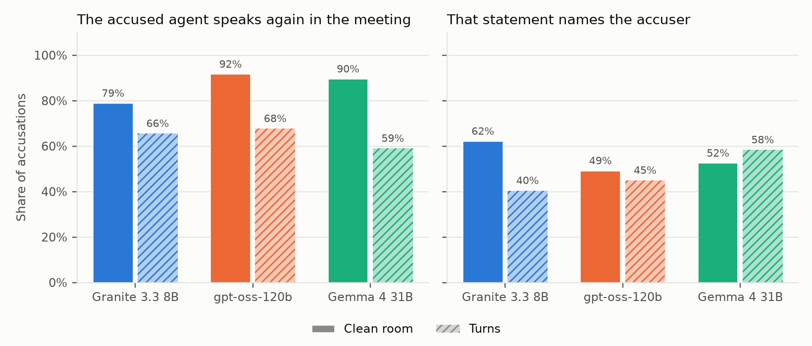

Figure 12. What agents pick up. The left panel is the share of accusations after which the accused agent speaks again in the meeting, and the right panel is the share of those answers that name the accuser.

- Hearing. In the clean room each reader receives every statement up to the tick, so the record is complete except for the statements made in the same tick, which average 2.8 to 3.9 per statement. An agent has heard 36 to 42 earlier statements when it speaks. The accused agent speaks again in the same meeting after 79% (Granite), 92% (gpt-oss) and 90% (Gemma) of accusations, and its next statement names the accuser in 62%, 49% and 52%. In turns the answers name the accuser in 40%, 45% and 58%.

### What agents think before they vote

The run with private reasoning (`CAPTURE=1`, tag `v6-granite-think`, 110 games) gives the reasoning of each Granite agent before each reply and each vote, and `scripts/analyze_p2_thoughts.py` reads it. Each agent wrote the reasoning for itself and the reasoning is not shared. The reasoning is 73% of the completion tokens, with about 2% of the replies cut at the limit of 384 tokens. The tables cover the honest votes, with the last reasoning before each vote.

| Group | Votes | Reasoning calls someone a liar | Votes for a liar it called out | Votes for another agent | Named liars that are Byzantine | Target never mentioned | Cites the crowd | Crowd cite hit a Byzantine | No crowd cite hit a Byzantine | Source cited is Byzantine |
|---|---|---|---|---|---|---|---|---|---|---|
| none | 135 | 4% | 50% | 50% | 0% | 1% | 18% | 21% | 33% | 19% |
| sequential | 98 | 31% | 93% | 7% | 31% | 3% | 78% | 24% | 68% | 46% |
| timed | 1036 | 74% | 96% | 4% | 25% | 0% | 77% | 28% | 38% | 34% |

| Role | Thoughts | Intent to deflect, mislead or blame | Mentions a teammate |
|---|---|---|---|
| honest | 13990 | 2% | 0% |
| byzantine | 4992 | 59% | 15% |

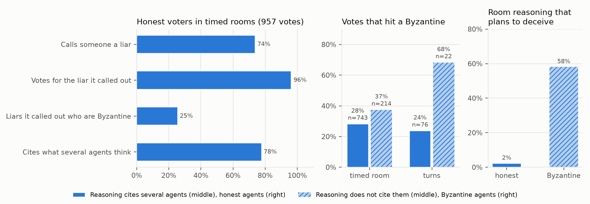

Figure 13. Private reasoning of Granite 3.3 8B. The left panel is the reasoning before the votes of honest agents in timed rooms. The middle panel is the share of votes that hit a Byzantine, split by whether the reasoning cites what several agents think. The right panel is the room reasoning that states an intent to deflect, mislead or blame.

- Knowing and choosing anyway. In the timed rooms 74% of the votes follow reasoning that calls some agent a liar or inconsistent, and in 96% of those the agent votes for the agent it called a liar. Honest voters rarely vote against their own accusation. The agents they call liars are Byzantine in 25% of the cases, which is no better than chance. The failure is in the belief and not in acting on it.
- Following the crowd. 77% of the votes in timed rooms follow reasoning that cites what several agents think ("multiple agents have confirmed"). Those votes hit a Byzantine in 28% of the cases against 38% for the votes without such a citation. In turns the figures are 24% (76 votes) against 68% (22 votes). Citing the crowd goes with worse votes, and the data do not show that it causes them.
- Byzantine intent. 59% of the room reasoning of the Byzantine agents states a first-person intent to deflect, mislead or blame, against 2% of the honest agents, and 15% of it mentions a teammate. The Byzantine agents know that they lie, and the honest agents do not detect it.
- Without a discussion the honest voters call someone a liar in 4% of the votes and hit a Byzantine in 33% of the votes that do not cite the crowd, from 135 votes.

## Later work

These tasks start after the current ones (the P2 reruns with required votes, the vote reading and the transcript analysis).

### A visual world in Godot

The plan is in `docs/godot-world.md`, and the first map is drawn in `docs/media/godot-world-map.png`. This section keeps the summary.

The goal is a world that people can watch and play in, and that agents can live in. Rooms have sprites and sounds, humans can join as players, and the same world runs as a visible simulation or as a headless one for experiments. The situation room stays the place where meetings happen.

What the world has to do.

- Rooms with sprites and sounds, and a ship that a player runs around in. Movement is continuous and not a jump between room names.
- Audio with distance and room physics. Sound gets quieter with distance, walls and doors block or muffle it, and a meeting room sounds different from a corridor. The audio work of P1b (per-reader mixes, overlap, Kokoro voices and Whisper recognition) is the starting point.
- Agents that perceive. Each agent receives a video stream of what it sees and an audio stream of what it hears, and it updates its own memory of what is happening in the rooms. Today an agent reads a text observation log that the engine writes, so this replaces the log with a perception step and a memory update step, and the memory becomes part of what is measured.
- Humans and agents in one world. A human uses the browser, an agent uses the streams, and both act through the same game rules.
- The situation room for meetings, with the timed discussion, the transports and the vote of this document. The human seat in a timed meeting is not supported yet and becomes part of this work.

Why Godot. It is scriptable, it exports to the browser, and the same project can run without a display for experiments. A browser build that uses threads needs the page to be cross-origin isolated, which means serving it with the `Cross-Origin-Opener-Policy: same-origin` and `Cross-Origin-Embedder-Policy: require-corp` headers. Players in different places also need a server that stores the game state. Both points are to be checked against the Godot version when the work starts. A test on 2026-11-11 showed that the PubApps proxy passes WebSockets over `wss://`, and a game on HiPerGator reaches browsers through a reverse SSH tunnel to the VM, because a browser outside the cluster cannot reach a compute node. A test on 2026-11-12 showed that the tunnel works. Players of a hosted game use their own Navigator keys, and the owner of a key pays for the agents it funds.

Decided. The first version is 2D and top-down, written in GDScript on Godot 4.7, on the condition that a conversation stays within its walls. It is both a playable game and a watchable simulation on one server, which runs on either the demo site or HiPerGator. Speech is heard in its room, muffled through a wall and heard through an open door, and the server computes this from the map, since Godot's 2D audio has no occlusion of its own. The test of the condition is in the plan.

The first map is a tile map of 80 by 45 tiles with the 14 rooms and the neighbours of the simulation, laid out like the ship in `frontend/static/images/Skeld.png`. Its walls and doors give the same neighbours as `config/settings.py`, which a test checks.

Open design questions.

- How often an agent samples video, and what a frame costs, since a vision model reads every frame it is shown.
- What the memory update looks like, for example a short text summary written after each interval, and how it is kept comparable across models.
- Which models may read video and audio. The Nemotron Omni model is waiting for an answer from Research Computing, and the model rule of this project applies to every model in the loop.
- Whether the game server is authoritative, and how a seed fixes a run so that experiments repeat.
- The art and sound assets. They have to be original or licensed for this use.

## Open questions

- Wall-clock scenario, to measure what inference latency costs a model. Adapters would hear continuously and post when ready.
- Approval for models that are not on Navigator. `nvidia/Nemotron-3-Diarization` for model-based diarization, a speech separation model for the mix ear, and an eligible audio-capable model for the native ear, for which none is known yet.
- Human seat in timed mode. The current human input path uses a 30 s timeout per message.
- Default for `quiet_close_ticks`, to be set from the P1 pilot.
- The movement phase is still sequential. Making it simultaneous is a separate change.
